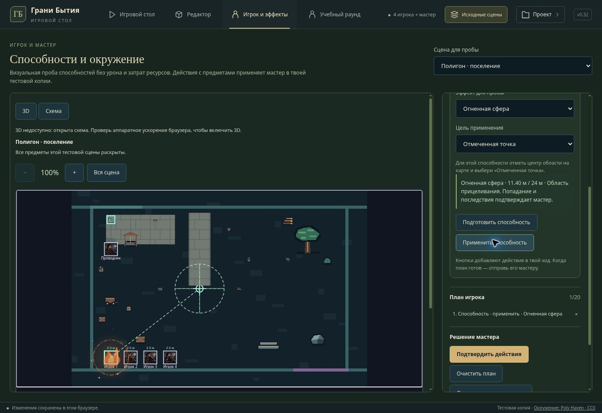

# v0.32 — эффекты способностей и действия игрока

Добавлена вкладка «Игрок и эффекты» в текущем приватном полигоне. Она использует текущую сохранённую сцену и тот же интерфейс действий, что экран героя. Можно выбрать стоящего на сцене героя, предмет, координаты и одну из шести визуальных проб. В поселении доступны четыре игрока. План ограничен 20 действиями; смена героя при заполненном плане заблокирована. Состояние предметов меняется после кнопки «Подтвердить действия» и возвращается кнопкой отмены. Изменённая извне сцена блокирует устаревший план. Ошибка или отказ сохранения не оставляют частичного результата.

Пробы способностей не добавляются в библиотеки героев и не считают боевой урон, стоимость или магические последствия для материи. Они проверяют визуальное прицеливание и воспроизведение. Двери, замки, контейнеры, свет и перенос предметов используют существующие команды сцены. Предметы переносят стоящего на них героя один раз. Осмотр не генерирует скрытых сведений; превращение декорации в предмет инвентаря не добавлено.

## Прицел и интерфейс героя

Общий GameActionBar формирует предпросмотр из известных координат героя, собственной способности и выбранной точки/существа. Поддерживаются точка, сфера, луч и конус с настоящими радиусом, длиной, углом и вертикальным направлением. Контур и расстояние обновляются в SVG и Three.js; цель за пределами дальности или нулевое направление блокируют кнопку выпуска. Неизвестная высота не угадывается, контур не раскрывает неизвестных получателей. Контуры в личной карте обрезаются по видимым областям.

Выбор координат в экране героя сохраняет выбранный предмет: можно выбрать мебель, затем место и заявить перенос. Для онлайн-компонентов подготовлена передача собственной визуальной метаинформации и дальности в options способностей. Отдельный внешний Render/GitHub-сайт этой публикацией не обновлялся; опубликован приватный Sites-полигон.

## 3D VFX

Вместо общей фиолетовой проволочной сферы добавлены процедурные модели по палитрам каталога: пламя/угли, капли, осколки, рост, вихревые дуги, разряды и сигилы. Семейства используют эти мотивы; у каждого сохранён свой цвет. Пять стадий — подготовка, выпуск, распространение, воздействие, остаток. Частицы инстансированы; материалы и геометрия освобождаются однократно. Размер визуальной части не меняет метры области действия. Нет сетевых ассетов, новых библиотек или изменений правил.

Прицел, маркер, маршрут и новый эффект обновляются без пересоздания renderer. Новый выпуск запускается и при одновременном изменении геометрии предмета. Есть включение/выключение, пауза и повтор; поддержано уменьшение движения. Цикл воспроизведения завершается по длительности, останавливается на паузе и при скрытой вкладке. Личные карты получают только раскрытые эффекты и отсечение их частей. Лимиты — 8 исходных эффектов / 24 копии отсечения; экономный режим — 4 / 8. Эффекты не захватывают указатель, не отбрасывают игровые тени и не попадают в контактный проход.

## Проверки

- Основная подборка tabletop: 337/337 до последней регрессии совместного изменения двери/выпуска.
- Полный файл Scene3D UI после этой регрессии: 43/43; финальные три VFX UI-проверки после последней правки также прошли.
- Подборка UI лобби, Scene3D, preview и новой пробы: 226/226.
- Пространственные способности, визуальный каталог, исполнение и правила раунда: 77/77.
- Серверные заявления, восприятие и исполнение: 94/94.
- Браузер: дверь остаётся закрытой до подтверждения, открывается после него и закрывается отменой; источник света гасится/возвращается; сфера показывает область 2.5 м; цель 25.08 м при дальности 24 м блокирует выпуск; подтверждённое применение запускается, повторяется и ставится на паузу. Визуальная проба не требует входа или сервера.
- TypeScript, production-сборка и проверка diff выполняются перед публикацией.

Облачный браузер не имеет WebGL. Скриншоты показывают настоящий интерфейс и эффекты режима схемы. Three.js-модели и геометрия проверены в Node, UI renderer заменён тестовым; итоговый GPU-вид и FPS не проверены.

