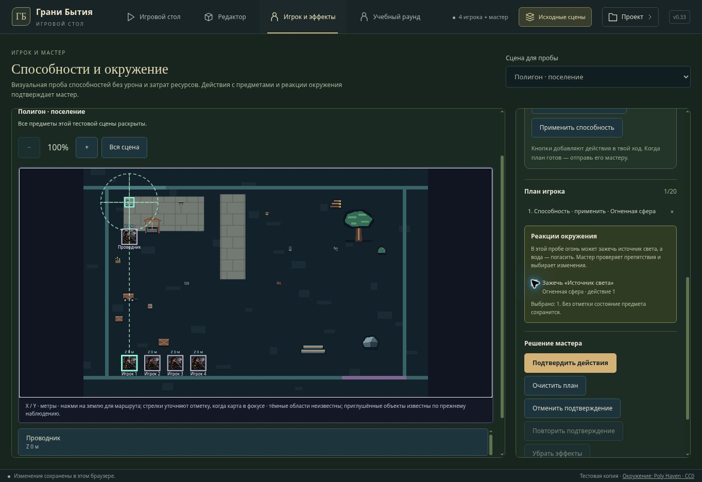

# v0.33 — прицеливание и реакции окружения

Во вкладке «Игрок и эффекты» можно навести пространственную способность на предмет или существо одним выбором на сцене. Прицел следует за раскрытым центром цели; нажатие на землю или ввод координат переключает его на ручную точку. Общая панель действий показывает число и имена известных отметок внутри контура. Проверка учитывает высоту, радиус сферы, длину и угол конуса, направление луча и включение самого героя. Список не раскрывает скрытые предметы, звуковые контакты, неизвестную высоту или запомненные отметки вне видимой области. Центры не заменяют проверку препятствий и попаданий мастером.

Поля X/Y/Z сохраняют ввод с десятичной запятой, отрицательные и промежуточные значения. Очистка или незавершённая координата снимает старую ручную цель; способность не выпускается по прежней точке. Выбор сцены и героя заблокирован при заполненном плане.

## Огонь, вода и состояние предметов

Добавлены две явные реакции локальной пробы: огненная сфера может зажечь выключенный источник света, а водяной поток — погасить включённый. После добавления способности мастер видит подходящие источники и выбирает нужные флажки. По умолчанию все реакции выключены. Нет автоматического горения дерева, урона, затрат ресурсов или новых канонических правил взаимодействия с материей.

План рассчитывается по порядку: погашенный ранним действием источник может быть зажжён последующим. Изменение очереди снимает старые одобрения. Неизвестная, устаревшая или повторная реакция отклоняет подтверждение целиком. Все изменения сохраняются одной операцией через существующие команды предметов; ошибка сохранения не оставляет частичного результата.

История хранит до 12 подтверждений. Отмена и повтор возвращают весь составной результат, включая состояние предметов и журнал; повтор воспроизводит эффекты заново. Внешняя правка сцены блокирует устаревшую историю. Новое подтверждение после отмены очищает ветку повтора.

## Свет и контакт с поверхностью

В Three.js светящиеся эффекты кратко освещают окружающую геометрию. Не больше двух дополнительных источников света одновременно, без динамических теней. Экономный режим и личные карты с ограниченным восприятием не создают эти источники; отсечённый эффект также не освещает скрытую часть сцены. Пауза, завершение, отключение и освобождение эффекта убирают его свет.

Для цели у земли добавлен отдельный след в стадиях воздействия и остатка. Приподнятая цель не получает след на земле. Геометрия использует существующее отсечение, не перехватывает выбор предметов и освобождается вместе с эффектом. Сохранены общие ограничения количества эффектов и копий отсечения.

## Проверки

- Полная подборка tabletop: 351/351.
- Лобби и черновики, пространственные способности, исполнение и правила раунда: 235/235.
- Новые сценарии пробы: 17/17, включая геометрию, известные цели, ввод координат, порядок реакций и составную отмену/повтор.
- TypeScript прошёл. Production-сборка выполняется официальным helper перед публикацией.
- Браузер: источник погашен обычным действием; огненная сфера наводится на его центр; реакция изначально не выбрана; после одобрения источник загорается; отмена гасит его, повтор зажигает. Водяной поток предлагает погашение по тому же сценарию.

Облачный браузер не поддерживает WebGL: снимок показывает настоящий интерфейс в режиме схемы. Геометрия, свет и освобождение Three.js проверены в Node; итоговый GPU-вид и FPS на пользовательском компьютере не проверены. Публикация обновляет приватный Sites-полигон. Внешний Render/GitHub-сайт этой версией не развёртывался.

