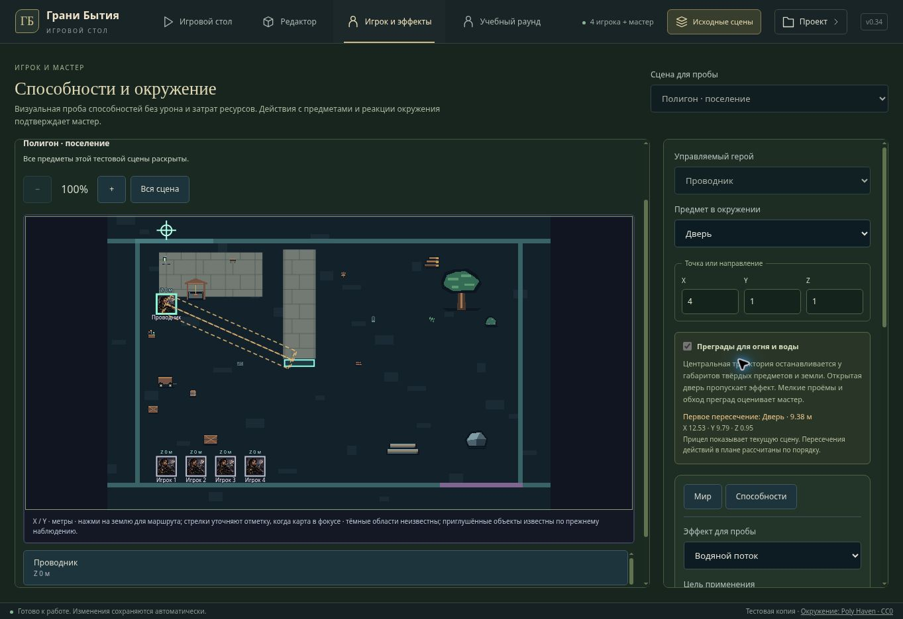

# v0.34 — физическая траектория локальных проб

Для огненной сферы и водяного потока во вкладке «Игрок и эффекты» добавлена проверка первого пересечения центральной траектории. Она использует сохранённые габариты объектов с `blocksMovement`, их высоту и положение, а также уровень земли. Сохранённые ширина и глубина уже учитывают поворот объекта; повторный поворот габаритов не применяется. Открытая дверь и постоянная арка пропускают эффект. Пересечение выбирается по расстоянию, с устойчивым выбором при совпадающих гранях.

Контур обрывается у преграды и меняет цвет на янтарный. В схеме и Three.js показана отметка столкновения; панель сообщает имя, расстояние и X/Y/Z. Сфера получает центр воздействия у преграды, луч — сокращённую длину. Подтверждённый эффект использует ту же точку. Прицел остаётся допустимым: препятствие меняет место визуального воздействия, а не запрещает выпуск. Дальность и границы первоначальной цели продолжают проверяться до расчёта столкновения.

## Реакции и порядок

Реакции света проверяются по полученной области и отдельному отрезку до центра источника. Поэтому огонь у лицевой грани стены не зажигает лампу за стеной, даже если её центр попал в радиус сферы. Вода не гасит источник за преградой. Флажки реакций по-прежнему выключены по умолчанию; их выбирает мастер.

Каждая способность рассчитывается в состоянии сцены на своём шаге плана. Открытие двери перед выпуском пропускает поток; открытие после выпуска не меняет уже рассчитанное столкновение. Пересечения показаны рядом с соответствующими действиями. Текущий прицел показывает фактическую сцену, а список действий — результат последовательного расчёта; эта разница объяснена в панели.

Переключатель «Преграды для огня и воды» позволяет вернуться к свободному визуальному просмотру. Его состояние фиксируется на время заполненного плана. Устаревшая реакция, ошибка действия или отказ сохранения не оставляют частичного результата. История отмены и повтора сохраняет полученные точки эффектов вместе с состоянием сцены и журналом.

## Границы реализации

Это правила двух неканонических упражнений, а не универсальная физика магии. Исцеление, тени, остальные пробы и утверждённые способности героев не получают новое правило столкновений. Онлайн-протокол и серверные формулы не менялись. Полная сцена используется только внутри локального полигона; общий GameActionBar получает необязательное преобразование прицела и сам не запрашивает скрытые объекты.

Проверяется центральный отрезок по габаритам, не каждая частица и не треугольники моделей. Мелкие отверстия, проход вокруг открытой створки, течение воды, разрушение, пробитие и сложная материальная физика остаются за мастером. Боевой урон и расход ресурсов в пробе не считаются.

## Проверки

- Полная подборка tabletop: 358/358.
- Общий игровой интерфейс и черновики лобби: 167/167.
- Локальная проба: 24/24, включая высоту, землю, грани, повёрнутые размеры, ближайшее пересечение, укрытие, порядок, свободный просмотр и отмену/повтор.
- Three.js UI проверяет янтарный цвет, дополнительные линии отметки, точку завершения и сохранение существующего renderer.
- TypeScript прошёл; production-сборка выполняется официальным helper перед публикацией.
- Браузер: в поселении водяной поток заканчивается у закрытой двери на расстоянии 9.38 м; строка столкновения появляется в плане. После подтверждённого открытия двери предупреждение исчезает и луч проходит дальше.

Облачный браузер не поддерживает WebGL. Снимок показывает настоящий интерфейс в режиме схемы; итоговый GPU-вид и FPS не проверены. Обновляется текущий приватный Sites-полигон, без развёртывания внешнего Render/GitHub-сайта.

