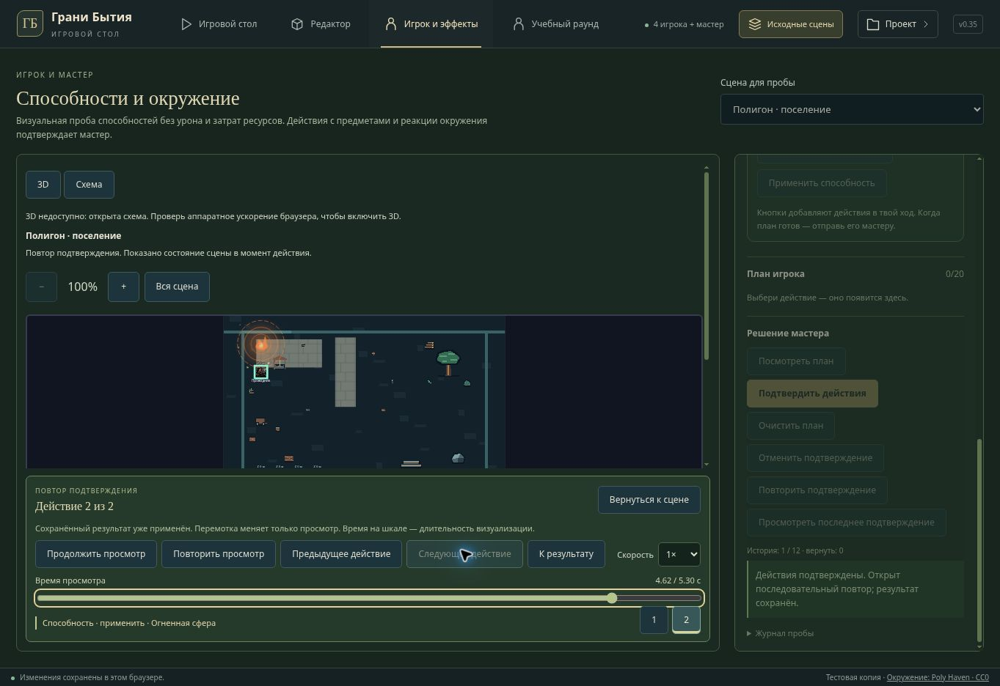

# v0.35 — последовательный просмотр плана

Во вкладке «Игрок и эффекты» добавлены предпросмотр плана до подтверждения и последовательный повтор после сохранения. Прежнее одновременное воспроизведение всех способностей заменено общей шкалой действий. Можно поставить просмотр на паузу, перейти к предыдущему или следующему действию, выбрать номер шага, перемотать ползунком, перейти к итогу, повторить и выбрать скорость 0.5× / 1× / 2× / 4×.

Компактная панель находится под сценой; выбранный шаг выделяется. Для начала новой работы используется кнопка «Вернуться к сцене». Во время просмотра редактирование, перенос объектов, смена героя и сцены закрыты, чтобы действия не составлялись по историческому изображению. Предпросмотр сохраняет очередь и выбранные реакции при возврате к текущей сцене.

## Состояние сцены и время

Чистый расчёт плана записывает состояния до и после каждого действия, его визуальные эффекты и сообщения журнала. Эти снимки рассчитаны теми же командами, что окончательный результат. При просмотре способности состояние её реакции переключается в начале стадии воздействия — на 65% визуальной длительности. Поэтому сначала виден водяной поток, затем гаснет свет; следующая огненная сфера начинает свой шаг при погашенном источнике и может зажечь его в своей стадии воздействия.

Осмотр, подготовка, взаимодействия и выпуск способности сохраняют отдельные шаги. Состояния действий берутся по порядку, поэтому открытие двери до выпуска продолжает влиять на траекторию. На экране в каждый момент воспроизводятся эффекты одного действия.

Время на шкале — длительность визуализации, не время раунда или каноническая скорость действий. Шаг взаимодействия показывается 650 мс, подготовка — 900 мс, выпуск — в пределах длительности его визуальной спецификации. Игровые ресурсы, урон и серверные часы этим просмотром не считаются.

## Сохранение, повтор и отмена

Предпросмотр и перемотка не вызывают сохранение. Подтверждение записывает итог одной операцией и открывает повтор; его просмотр уже не выполняет действия второй раз. История хранит запись вместе с итогом и журналом. Отмена возвращает сохранённое состояние, а повтор подтверждения восстанавливает результат и его последовательный просмотр. Можно вновь открыть последнее подтверждение.

Отказ сохранения оставляет очередь и текущий мир. Внешняя правка сцены немедленно закрывает устаревший просмотр; устаревшая очередь остаётся заблокирована до пересмотра. Скрытая вкладка не продвигает курсор, ручная перемотка ставит его на паузу, завершение останавливает таймер. При reduced motion подтверждение открывается на паузе с доступными ручными шагами.

## Схема и Three.js

Оба режима получают один и тот же внешний курсор времени и используют общий расчёт пяти стадий эффекта. Пока действует внешняя шкала, собственные часы эффекта не запускаются. Смена времени в Three.js обновляет существующий эффект и не пересоздаёт renderer. Изменение состояния самой двери или светильника по-прежнему перестраивает соответствующий снимок сцены, когда это необходимо.

Схема также получила общий расчёт локального прогресса стадий; её самостоятельный цикл теперь заканчивается по фактической максимальной длительности эффектов. Во время общего просмотра прежние отдельные кнопки повтора/паузы скрыты. Пауза фиксирует позиции и стадии, а ручной поиск может двигаться назад.

## Проверки

- Полная подборка tabletop: 368/368, включая новые сценарии.
- Локальная проба после финальной компоновки: 32/32.
- Three.js и SVG UI: 46/46; проверки курсора подтверждают одинаковые фазу и позицию, отсутствие самостоятельного хода и сохранение renderer.
- TypeScript прошёл; production-сборка выполняется официальным helper перед публикацией.
- В браузере собрана цепочка воды и огня с двумя выбранными реакциями. Предпросмотр открывается без записи и блокирует редактирование. Переход к действию 2 и перемотка показывают только огонь в стадии воздействия. Возврат сохраняет очередь; подтверждение открывает отдельный повтор и создаёт одну запись истории.

Публикуется текущий приватный Sites-полигон. Онлайн-протокол, канонические способности и внешний Render/GitHub-сайт не развёртывались. Облачный браузер не поддерживает WebGL: снимок показывает настоящий режим схемы, итоговый GPU-вид и FPS не проверены.

