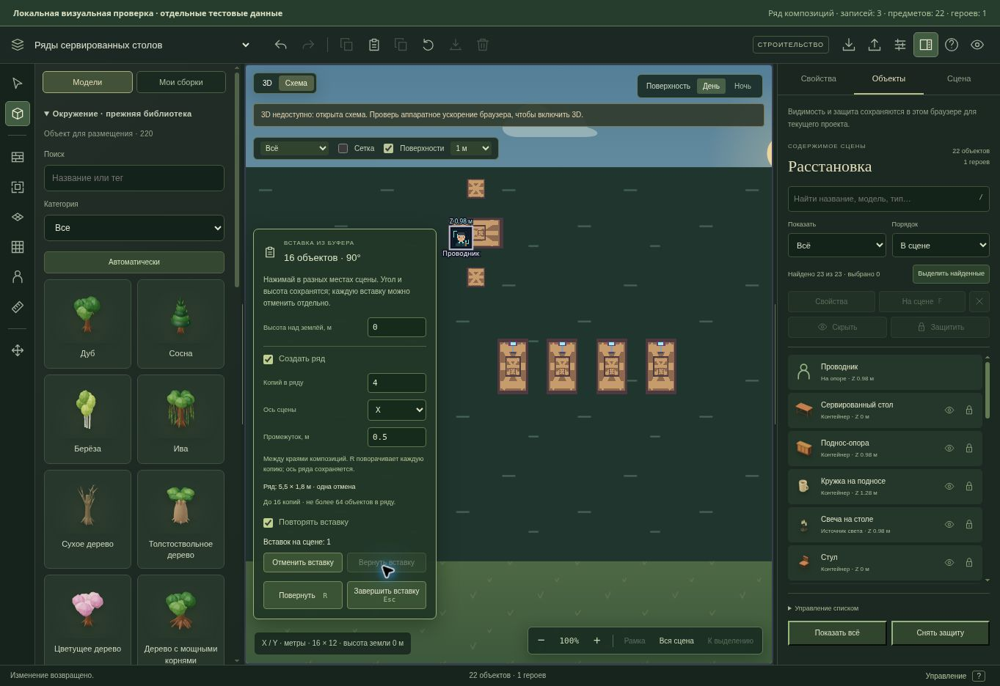

# Ряд композиций в редакторе

28 октября 2026. Продолжение рабочей версии редактора основного сайта «Грани Бытия».

## Создание ряда

После копирования предмета или композиции и Ctrl+V в панели доступен переключатель «Создать ряд». Мастер задаёт количество копий, ось X/Y сцены и промежуток между краями полных габаритов композиций. Панель показывает размер всего ряда и допустимое число копий. R поворачивает каждую копию; выбранная ось сцены сохраняется. Нулевая дистанция ставит соседние габариты вплотную, отрицательная не допускается.

В предпросмотре виден весь ряд с реальными размерами и состояниями исходных предметов. Привязка к сетке и границам применяется к ряду целиком. Отдельные копии у края не сдвигаются независимо и не теряют заданный промежуток. Если целый ряд не помещается, запись не выполняется.

Одно нажатие на сцену создаёт весь ряд и один шаг истории. Все предметы получают новые идентификаторы; высоты и взаимное расположение внутри каждой композиции сохраняются. Герои остаются на исходных опорах. Получившийся ряд можно перемещать как выделенную группу, сохранить в сборку и экспортировать существующим форматом.

Переключатель «Повторять вставку» позволяет размещать целые ряды, меняя их параметры между нажатиями. Счётчик и кнопки теперь называются «Вставок на сцене», «Отменить вставку» и «Вернуть вставку»: один ряд считается одной вставкой, даже если содержит несколько композиций. Отмена и возврат сохраняют предпросмотр и не затрагивают историю до начала текущей расстановки. Esc завершает режим и выделяет последнюю оставшуюся вставку целиком.

## Ограничения и сохранность

В одном ряду допускается до 64 объектов, а в сцене — прежние 250. Например, композиция из четырёх предметов позволяет сделать до 16 копий в ряду. Для исходника более 32 объектов создание ряда выключено с пояснением; обычная вставка остаётся доступной. Предельный размер не меняет прежний формат сборок.

Пустое, дробное или недопустимое количество копий и неверный промежуток показывают понятную ошибку и убирают предпросмотр. Вместо ошибочного ряда одиночная копия не подставляется. После исправления параметров можно продолжить работу. Нехватка высоты, границ, лимита объектов и отказ сохранения отклоняют весь ряд без частичной записи и лишнего шага undo.

Изменение параметров, отмена, новый запуск, внешняя замена черновика и смена контекста сохраняют защиту от устаревшего жеста. Настройки ряда относятся только к текущей вставке. Новый Ctrl+V после завершения начинает обычную вставку с выключенными рядом и повторением.

Новые записи используют существующий атомарный путь редактора. Формат сцен, серверные маршруты, права, миграции и игровые правила не менялись; ряд сохраняется как обычные независимые объекты.

## Проверка

Добавлены 13 сценариев: 6 проверяют геометрию и совместимость, 7 — настоящий React-интерфейс. Проверены оба направления и четыре поворота, точный и дробный промежуток, границы и сетка, новые ID, сохранность исходника и героя, полный undo/redo, изменение параметров между рядами, ошибочный ввод, отказ записи, пределы 64/250 объектов, устаревший жест и смена контекста. Результат проверен через сохранение/чтение сборок и повторный штамп.

| Проверка | Результат |
| --- | --- |
| Финальный целевой прогон редактора и сборок | 107/107 |
| Полный `npm run test:ui` | 352/352 |
| Полный `npm run test:tabletop` | 434/434 |
| TypeScript и production-сборка | Успешно |
| Линтер | 0 ошибок; 49 прежних предупреждений |
| `git diff --check` | Без ошибок |

Наборы пересекаются; их числа не складываются. Полные итоговые TAP-сводки проверяются вместе с нулями fail/cancelled/skipped/todo. Логи и машинная сводка находятся в `.verification/assembly-row/`; для целевого набора используется `targeted-final.log`. Сборка сохраняет прежнее предупреждение о размере отдельных JS-модулей.

В управляемом браузере проверен настоящий SceneEditor с отдельными тестовыми данными и записью в память проверочной страницы. Из исходной сервировки в четыре предмета создан ряд из четырёх копий по X, с углом 90° и промежутком 0,5 м. Размер ряда — 5,5 × 1,8 м. Одна запись дала 22 предмета и одного исходного героя; одна отмена вернула 6 предметов, возврат восстановил 22. Завершение выделило все 16 предметов ряда без дополнительной записи. На схеме осмотрены общий предпросмотр и расположение ряда. Проверочная страница удалена после осмотра.

WebGL в этом браузере недоступен: визуально проверена схема. Работа пользовательского GPU, свет и FPS этим прогоном не подтверждены.

Изменения находятся в `work/editor-integration`. Публичный GitHub, основной сайт, API и производственная база этим шагом не обновлялись.
