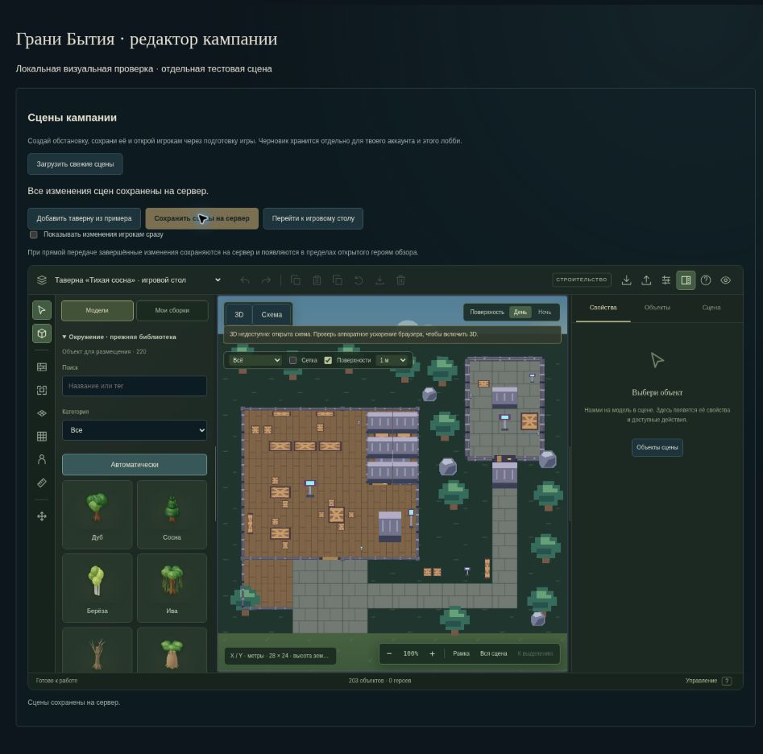

# Интеграция редактора в основной сайт

28 октября 2026. Подготовленная рабочая версия, до публикации основного сайта и API. Следующий этап добавил [согласование черновиков с сервером](scene-draft-merge-review.md); ниже сохранён отчёт первоначального переноса.

## Что изменилось

Основное React/Vite-приложение получает общую реализацию редактора и ассеты из закрытого полигона v0.35 (исходник Sites `be04deb5446ce53e53585e0fcc9a1c91461f5ef8`). Производственная сборка использует обычный вход в приложение; флаг `VITE_PREVIEW_ONLY=true` из отдельного размещения не перенесён. Идентификатор и конфигурация закрытого Sites также не включены в GitHub-проект.

Во вкладке «Редактор» прямой конструктор сцен теперь доступен главному мастеру и помощникам с разрешением `scenes`. Раньше мастер попадал в общий редактор, публикующий весь мир, а отдельный конструктор использовал только ограниченный помощник. Полный редактор листов и кампании сохранён в раскрываемом разделе ниже. Из игрового стола есть прямой переход к редактору сцены.

Сохранение сцен использует узкий `/lobbies/:id/scenes`: не отправляет листы и часы. После успешного сохранения доступен переход к игровому столу и существующей подготовке игры. Фигурки реальных, принятых мастером героев размещаются через подготовку сцены с явным раскрытием. Игроки используют прежние серверные заявления, расчёт и отдельное применение раунда.

Таверна из примера добавляет самостоятельную сцену из 203 редактируемых объектов с новыми идентификаторами. Существующие сцены, персонажи и их расположение сохраняются. Повторное добавление создаёт вторую самостоятельную таверну. Тестовые игроки полигона не копируются, лимит 20 сцен сохраняется.

Редактор включает актуальную геометрию, окружение, миниатюры, группы и собственные сборки, перенос на опоры, масштаб, слои, копирование между сценами, поиск, панели, импорт/экспорт и undo/redo. Локальные неканонические пробы способностей, реакций и повтор плана остаются в Preview3D; они не становятся сетевыми действиями или новыми правилами героев.

## Сохранение и конфликты

- Пока идёт прямая передача, мастер продолжает редактирование. Успешный ответ подтверждает отправленный снимок и сохраняет более новые локальные изменения; следующий PUT использует новую ревизию.
- Новая серверная ревизия приостанавливает автоматическую передачу и блокирует ручную запись устаревшего черновика. Локальную работу можно продолжить и экспортировать перед загрузкой свежих сцен.
- Серверная проверка версии и разрешений остаётся окончательной; гонка между проверкой интерфейса и запросом не обходит её.
- Смена аккаунта или лобби создаёт отдельный контекст. Смена доступа к API отменяет предыдущую загрузку; поздний ответ не заменяет свежий черновик.
- Повторный клик не создаёт второй параллельный запрос. Ранее захваченный callback не меняет черновик во время ручного сохранения.
- Ошибка и недоступное хранилище сохраняют работу в памяти с уведомлением. Прямая передача включается пользователем, по умолчанию выключена.

## Проверка

`npm run verify:local` завершён со статусом `passed: true`: все шесть этапов прошли. Полные тестовые отчёты завершены; нулевой код без итоговой сводки не принимался. Результаты сгруппированы по наборам и могут включать общие сценарии.

| Набор | Результат |
| --- | --- |
| Правила | 253/253 |
| Интерфейс и HTTP/UI | 310/310 |
| Сервер, SQLite и PostgreSQL/PGlite | 574/574 |
| Игровой стол, модели и редактор (отдельный прогон) | 372/372 |
| Инструмент проверки | 6/6 |
| TypeScript и Vite | Успешно |
| Линтер | 0 ошибок; 49 предупреждений в общей кодовой базе |

Сводка полного прогона: `.verification/2026-10-28T02-13-09-903Z-1b47ffa5/summary.json`; отдельный отчёт игрового стола проверен по завершённой сводке Node: 372 tests, 372 pass, 0 fail/cancelled/skipped/todo. Все тесты используют изолированные данные. При production-сборке осталось предупреждение о размере отдельных JS-модулей. После полного прогона в новом `LobbyScenesEditor` устранены четыре предупреждения React: состояние подтверждённого снимка вынесено в state, актуальный контекст синхронизируется после commit, смена API отменяет запрос без лишнего каскадного обновления. После этой правки повторно прошли все 310 интерфейсных проверок, 8 сценариев прямой передачи, линтер и production-сборка. Результаты: `.verification/editor-integration-followup/summary.json`. Серверная логика и правила не менялись. В новом компоненте предупреждений линтера нет.

Отдельный серверный сценарий выполнен на SQLite и PostgreSQL/PGlite: пустое лобби → четыре независимых аккаунта и утверждённых героя → добавление/поворот/сохранение таверны → отказ устаревшей и запрещённой записи → перезапуск → адресное раскрытие → четыре заявления → отдельный расчёт и применение → изменение двери → повтор без второго исполнения → архивирование сбора → финальная контрольная точка → закрытие лобби → повторный запуск и чтение всеми игроками. Закрытая сцена и чужой план не раскрываются. При сохранении обстановки листы и время не меняются; исполнение раунда создаёт обычный игровой журнал.

Настоящий HTTP/UI-сценарий мастера и двух игроков дополнен открытием редактора мастером, добавлением и сохранением таверны и переходом к игре. Сохранность исходного мира и отсутствие тестовых фигурок проверяются через API. Имеющийся сценарий продолжает проверять приём героев, раскрытие, заявления, применение, паузу, точку, перезапуск и следующий раунд.

В управляемом браузере осмотрен настоящий компонент редактора на отдельной локальной странице с тестовым адаптером сохранения: открытие, добавление таверны, состояние до/после сохранения и доступность перехода к столу. Эта визуальная проверка не подменяет HTTP-сценарии. WebGL в браузере недоступен, используется схема. Реальная 3D-отрисовка, качество света и FPS на пользовательском GPU остаются непроверенными.

## Публикация

В GitHub Actions добавлена подборка `test:tabletop`; серверные проверки ограничены двумя параллельными файлами для предсказуемого расхода памяти. Основной сайт, Render, рабочие аккаунты и база ещё не обновлены.

Подготовленная ветка включает накопленную серверную компонентную основу после опубликованного `main` (`679ab460f3e142a6883b005675b29a9b46926969`). При выпуске API выполнится добавочная миграция `014-components-postgres.sql`: четыре приватные таблицы компонентов и журнала с RLS и запретом PUBLIC. При первой новой записи кампании координатор создаёт её исходную запись компонентов и затем сохраняет изменения; прежние текущие миры и история не удаляются. Поэтому финальная выкладка охватывает сайт и API, а серверная миграция входит в её согласуемый объём. На рабочей базе этот шаг не выполнялся.
