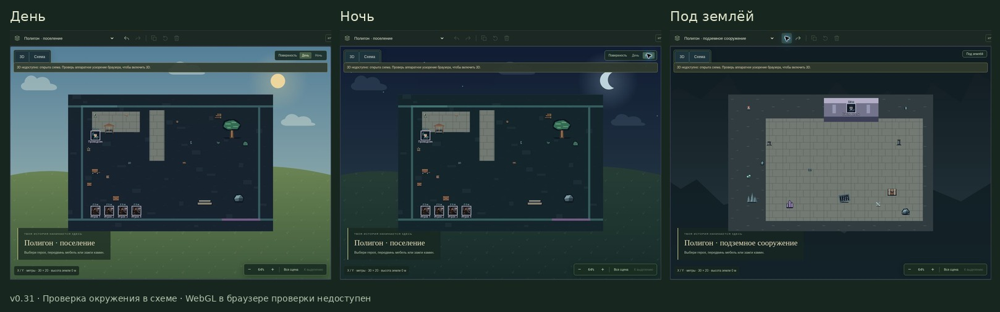

# v0.31 — окружение вместо пустого фона

На поверхности сцены появилась расширенная травяная платформа с земляным основанием и процедурной фактурой. Небо содержит облака и солнце, ночной режим — луну и звёзды. Небесное тело следует направлению основного света; его видимость зависит от ракурса камеры. Подземный режим заменяет траву каменной площадкой, а небо — тёмным пещерным окружением, приглушает общий свет и убирает солнечное излучение из отражений.

Окружение задаётся в параметрах сцены: автоматически, поверхность или под землёй. Старые исходные подземные сцены определяются по стабильному ID; каменная палитра поселения остаётся поверхностной. Явная настройка сохраняется, экспортируется, отменяется и передаётся в раскрытом описании карты. Изменений расстановки или игровых правил нет. Личные карты не получают платформу за границами раскрытия. Фоновая геометрия не перехватывает указатель; небо исключено из прохода контактных теней.

В схеме добавлена статичная атмосферная иллюстрация и переключатель дня/ночи. Фон также заполняет область загрузки WebGL. Настройки света остаются общими с 3D. Нет новых зависимостей, сетевых текстур, дополнительного цикла анимации или таймеров. Небо, поверхность и основание требуют три фоновых mesh; экономный режим сокращает геометрию и детализацию фактуры.

## Проверено

- 313 проверок основной подборки tabletop после интеграции: все прошли.
- 9 новых проверок окружения (геометрия, лучи, обе проекции, ресурсы, личные карты, сохранение, раскрытие, освещение): прошли в focused-подборке из 115 проверок.
- 21 проверка совместимости expanded-assets, 3d-sandbox и starter-campaign: все прошли.
- UI-проверки: день/ночь без пересоздания renderer; смена окружения; сохранение/отмена/возврат к автоматическому выбору; read-only; отсутствие фонового render loop. В общем скрипте tabletop теперь также включены обе новые подборки окружения.
- В браузере: исходное поселение, дневной/ночной вид, исходное подземелье; ручная смена подземелья на поверхность и отмена. Количество объектов осталось прежним.
- TypeScript и production-сборка выполняются перед упаковкой.

Облачный браузер не предоставляет WebGL. Скриншоты показывают реальный режим схемы. Настоящие Three.js-объекты и параметры света проверены в Node, renderer UI-тестов заменён; GPU-компиляция шейдеров, итоговый PBR-вид и FPS здесь не измерены.

