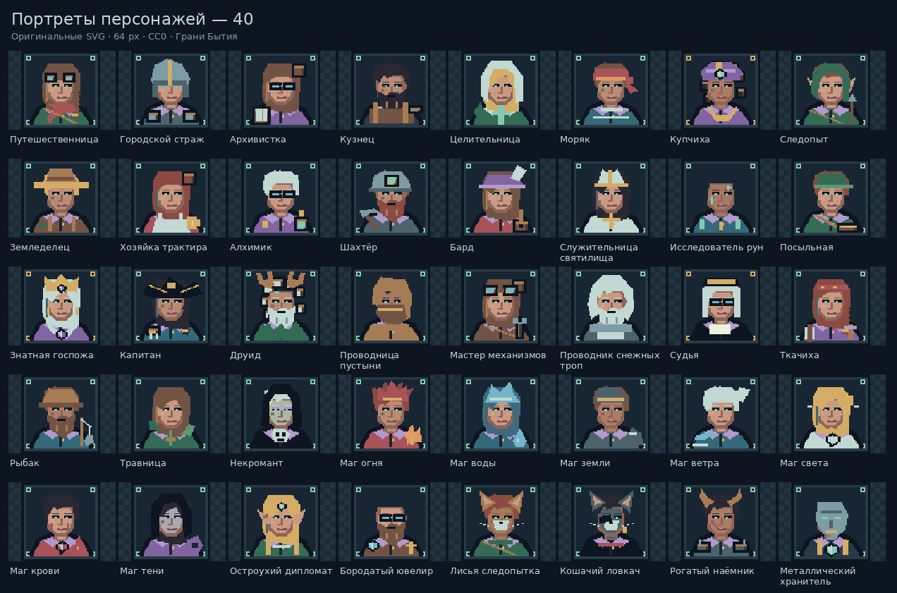
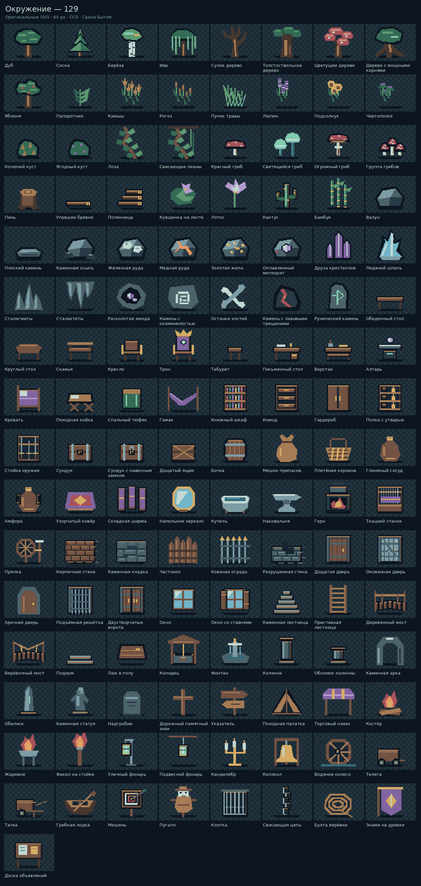
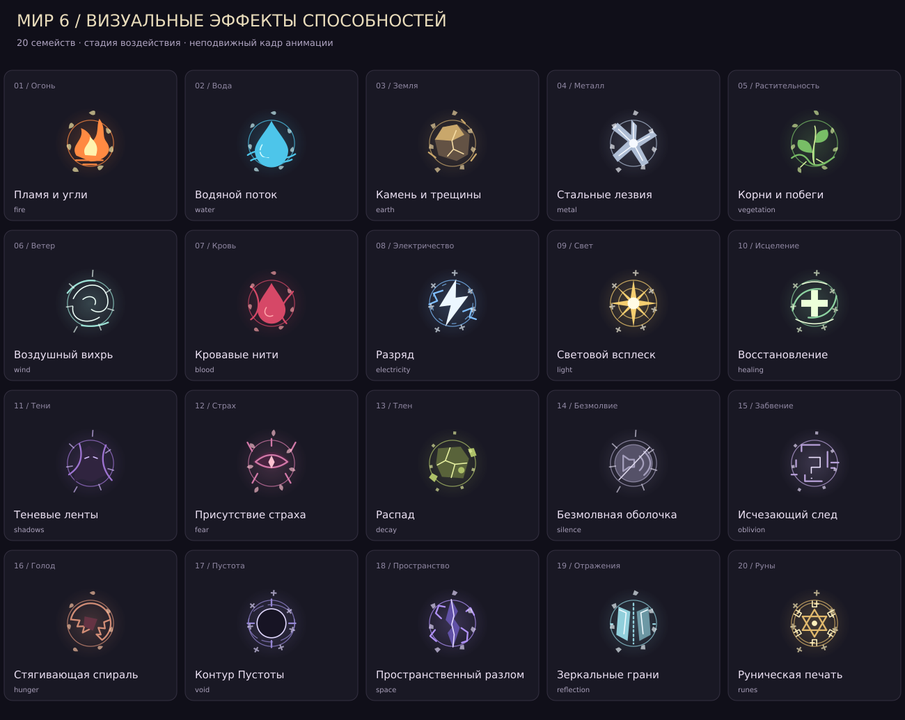

# Расширение визуальной библиотеки Мира 6

Персонажи и существа остаются портретами на токенах. Новая библиотека дополняет стартовые изображения; собственные загруженные изображения сохраняются.

| Группа | Новых изображений |
| --- | ---: |
| Поверхности и фоны | 48 |
| Окружение | 129 |
| Предметы | 72 |
| Портреты персонажей | 40 |
| Портреты существ | 28 |
| Всего оригинальных SVG | **317** |

Перекраски и кадры анимации не добавлены к этому счёту. Исходники находятся в `src/assets/expanded`, метаданные — в `manifest.json` и `src/expandedArtwork.ts`. Генератор `scripts/generate-expanded-assets.py` воспроизводит набор. CC0 в каталоге применяется только к новым SVG и их генератору. Изображения служат оформлением, а не дополнением к канону рас или способностей.

## Где использовать

- Конструктор сцен → «Библиотека окружения»: выбор объекта, размещение кликом, размеры и игровые свойства в параметрах объекта.
- Параметры объекта → «Изображение объекта»: замена рисунка с сохранением координат и свойств.
- Параметры сцены → «Фон сцены»: повторяемые поверхности автоматически заполняют сцену; размер повторения настраивается отдельно.
- Редактор персонажа/NPC: каталог портретов с категорией существ.
- Редактор предмета: изображения оружия, брони, инструментов и расходников.

Поиск использует русские названия и теги. Страница показывает до 24 миниатюр, выбранное изображение остаётся доступно при поиске и смене страницы. Изображение объекта сохраняется в кампании, резервной копии и индивидуальной памяти героя; скрытые изменения не обновляют прежнее наблюдение.

## Способности

Доступно **20 анимированных семейств**, пять стадий (подготовка, выпуск, распространение, воздействие, остаточный след) и формы точка/сфера/луч/конус. В редакторе способности можно выбрать оформление, отключить его, настроить масштаб, количество частиц и темп, посмотреть стадии и поставить анимацию на паузу.

На сцене подготовка и сохраняющееся воздействие показываются по состоянию применения. Новый наблюдаемый выпуск запускает последовательность; последнее применение можно повторить отдельной кнопкой. Координаты выпуска записываются в момент действия, поэтому последующее перемещение токенов не изменяет повтор. Старые применения без такого снимка не реконструируются предположениями.

Оформление не меняет расчёты, ресурсы, время, радиус или последствия способности. Повтор и пауза относятся только к изображению. Максимум 12 частиц на эффект; поддерживаются отключение эффектов и системное предпочтение уменьшенного движения.

Чужие эффекты выдаются игроку только для распознанного контакта с раскрытой высотой и отдельным разрешением мастера «Показывать наблюдаемые эффекты способностей этого существа». Скрытые источники и цели не передаются. В проекции нет названий тайных способностей, внутренних ID применений, формул и листов. Рисунок дополнительно ограничивается видимыми областями. Из полного фона игроку передаётся только известная повторяемая поверхность из общего каталога; произвольный фон всей сцены остаётся у мастера.

## Проверка

`npm run verify:local`: правила, интерфейс, HTTP/Socket.IO, SQLite/PostgreSQL, lint и сборка. Дополнительные проверки охватывают библиотеку, сохранение и память, раскрытие VFX, сохранённые координаты и неизменность последствий при смене оформления. Проверены 400 сочетаний семейства/стадии/формы и настоящий React-каталог с поиском, страницами и блокировкой редактирования.

Контактные листы SVG отрендерены и просмотрены визуально. Проверка анимации в настоящем браузере и на физическом телефоне в этой среде не выполнена.

