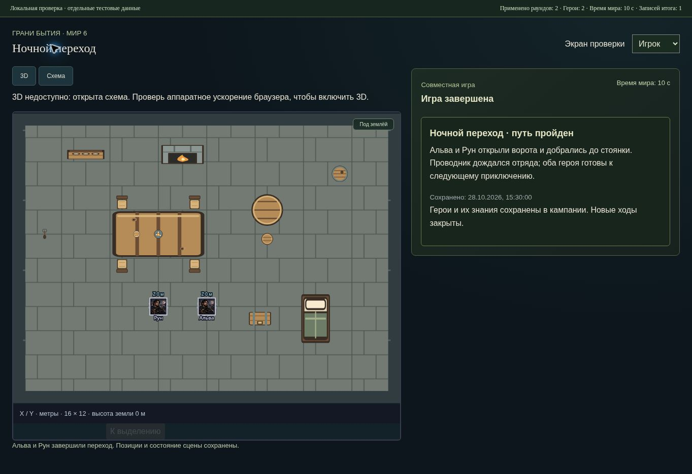

# Совместная игра от запуска до финала · 29 октября 2026

В рабочую версию добавлен общий игровой цикл: подготовка участников, начало, понятная фаза раунда, перерыв, продолжение и завершение с итогом для всех. Пошаговая инструкция: [play-with-friend.md](play-with-friend.md).

## Действия мастера и игрока

На игровом столе видны готовность и текущее состояние. Начало проверяет, что в лобби есть другой участник, его принятый герой размещён на открытой ему сцене. Старт закрывает набор, сохраняя мир и игровые часы. Дублирующий запрос не начинает игру повторно.

Игрок составляет очередь движения, взаимодействий, речи, ожидания, предметов и утверждённых способностей. Мастер закрывает приём, задаёт необходимые решения, сначала рассчитывает, затем отдельно применяет раунд. Существующая модель бюджетов, переноса работы, тела, ресурсов и магии сохранена. Следующий раунд продолжает ту же кампанию.

Перерыв доступен прямо на игровом столе. Позиции и планы сохраняются, исполнение продолжается после явного решения мастера. Подготовка сцены и полный редактор используют прежние права; помощник не получает право завершать всю игру только из-за разрешений на раунды.

«Завершить игру» открывает название и общий итог. Текст предназначен всем участникам, поэтому мастер проверяет его перед записью. Неразрешённый текущий сбор блокирует завершение. Незавершённые действия и заряды требуют отдельной отметки о сохранении в снимке; завершение само их не исполняет и не отменяет.

## Финальное сохранение

Сервер одной транзакцией создаёт финальную контрольную точку, записывает общий итог в чат, закрывает лобби и инвалидирует старые предпросмотры. При отказе снимка, нехватке места или ошибке аудита игра остаётся открытой: частичного финала и сообщения не возникает. Сохраняются прежние пределы контрольных точек — 20 точек или 32 МиБ; существующие точки автоматически не удаляются.

Команда защищена актуальной ревизией, главным мастером, составом лобби и ключом повтора. Повтор после потери ответа и перезапуска возвращает прежний итог без второго снимка. Другая команда с тем же ключом и повтор от бывшего мастера отклоняются. Черновик итога разделён по аккаунту и лобби; смена API отменяет старый запрос и освобождает интерфейс. Если серверный итог подтверждает потерянный ответ, сохранённая команда считается принятой.

Оба игрока читают общий итог, сохраняя индивидуальный доступ к сцене и знаниям. Полный снимок не входит в общий ответ. После закрытия недоступны новые ходы и изменения знаний, включая личные заметки; чтение сцены, состояния и журнала сохраняется. Исправлен прежний маршрут, позволявший менять знания в закрытом лобби.

Используются существующие контрольные точки и сообщения; новой схемы или миграции этот шаг не добавляет. Сохранение точки вынесено в общий помощник, используемый также прежней историей раундов.

## Вход и возврат

Ссылка на выбранное лобби и последнее открытое лобби помогают вернуться после обновления страницы или создания героя. Из пустого списка героев есть переход в редактор и обратно в кампанию. Прежние черновики планов не удаляются при переходах.

Приглашение содержит только путь сайта и код приглашения: прежний lobby, параметры входа и фрагмент URL не копируются. В HTTP-браузере без автоматического буфера обмена доступно поле для ручного копирования. Несовместимый успешный ответ старого API показывает ошибку и обновление состояния, сохраняя остальной игровой экран.

`npm run dev:all` запускает сайт и API одной командой. Добавлен `npm run dev:lan` для двух устройств в одной частной сети: частные IPv4 выводятся в терминал и добавляются в точные разрешённые origins, API по умолчанию остаётся на loopback. Явный `LAN_HOST` проверяется; отсутствие доступа к списку интерфейсов не ломает обычный локальный запуск.

## Проверки

| Проверка | Результат |
| --- | --- |
| Полный `npm run test:ui` | 382/382 |
| Полный `npm test` | 253/253, включая 53 прежних сценария |
| Полный серверный набор SQLite и PostgreSQL/PGlite | 597/597 |
| Связный HTTP/UI-сценарий мастера и двух игроков | Пройден внутри полного UI-набора |
| TypeScript и production-сборка | Успешно |
| Линтер | 0 ошибок, 49 прежних предупреждений, новых нет |
| Запуск сайта, прокси API и WebSocket через `dev:all` | Пройден |
| `git diff --check` | Без ошибок |

Суммы наборов не складываются: часть сценариев пересекается. Финальный UI-лог — `.verification/game-session/ui-delivery.log`, правила — `rules-complete.log`, сервер — `full/server.log`, сборка и линтер — `build-verified.log` и `lint-verified.log`. Машинная сводка: `.verification/game-session/summary.json`. Проверены конечные TAP-счётчики и длительности всех отчётов, нули fail/cancelled/skipped/todo. Неполные вложенные отчёты общего запуска не приняты за успешную проверку; итог составлен по завершённым отдельным прогонам.

Новый серверный сценарий на обеих базах использует главного мастера и два независимых аккаунта: приглашение → герои → раскрытие → старт → два плана → пауза → движение и дверь → перенос действия → второй раунд → перезапуск → общий финал → повтор → чтение игроками. Проверены отказ аудита, лимит снимков, конкурирующие старты и финалы, запрет изменений после закрытия и отзыв полномочий. Общий HTTP/UI-сценарий также завершает игру кнопками и читает итог обоими игроками после перезапуска.

В управляемом браузере проверены настоящие компоненты общего статуса и формы финала на отдельной визуальной странице: заполнение, явное подтверждение, один запрос, итог мастера и игрока, сохранность двух героев и времени 10 с. Эта страница использует отдельные тестовые данные и не подменяет HTTP-проверки. После осмотра она удалена.

Облачное окружение не предоставляет WebGL и запрещает получение сетевых интерфейсов. Здесь визуально проверена схема; GPU, FPS и подключение реального второго устройства по LAN не проверены. Локальный запуск, HTTP-прокси и WebSocket проверены; LAN-конфигурация дополнительно покрыта пятью сценариями. Сохраняется прежнее предупреждение сборки о размере JS-модулей.

## Выпуск

Изменения подготовлены в `work/editor-integration`. Основной GitHub, GitHub Pages, Render API и рабочая база этим шагом не обновлялись. Для интернет-игры требуется согласованный выпуск клиента и API. В накопленной ветке уже находится ранее подготовленная миграция `014-components-postgres.sql`; она относится к отдельному согласованию производственного выпуска. Этот шаг не выполнял её на рабочей базе.
