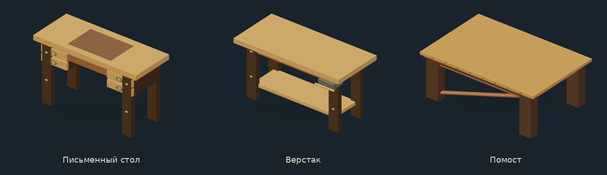
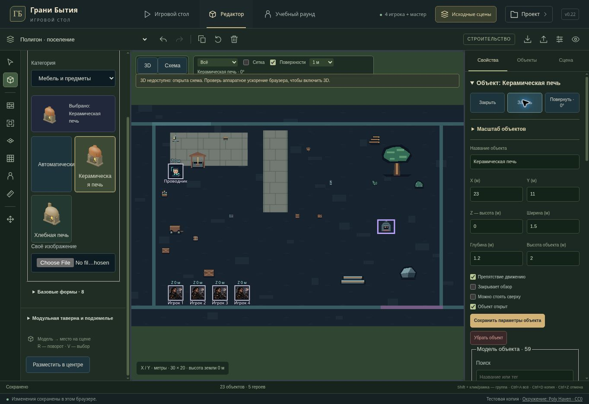

# Old environment library — v0.22

Continues the original 220-asset library and existing scenes. No new showcase scene, change of scene IDs, save schema, campaign canon or hosting audience.

## Changes

- Added controls for existing old drawer/cabinet/wardrobe/sack/oven/coop/carriage/shutter/grate/drawbridge models using the existing open, locked and active fields. Only models with the relevant constructed parts offer these actions. Desk drawers have no invented lock; ovens expose their door and fire controls separately. A pre-existing custom lock can still be cleared.
- Forge, ceramic kiln and bread oven now use actual emitter geometry for local lights. The forge light anchors to its exposed upper glow; closed oven fire doors keep room lighting inside. Flame parts do not cast opaque shadows. Existing light/shadow budgets and remembered/restricted-view protections remain in force.
- Old furniture saved as kind `platform` uses the same move-intent capability in the 3D viewport, action bar and round executor. A player gesture still queues an intent; application requires the master's existing confirmation. Structures and remembered objects do not acquire this capability, and the cursor matches the allowed action.
- Desk, workbench and platform have continuous saved-height flat tops. The desk inlay is joined flush without overlapping coplanar faces, its drawer motion envelope is symmetric, and fixed bodies stay stationary across states. Verified safe width/depth ratios are .92/.70, .92/.80 and .92/.88 respectively, including rotated and resized objects. Triangle counts decreased in both LODs: desk 5868/908, workbench 1480/204, platform 1504/200.
- Automatic surface placement recognizes old furniture and conservative old model footprints. An old chair, bed, wardrobe, shelf or mechanism is not treated as a flat tabletop merely because an earlier save has canSupport=true. Saved flags and manual support assignments remain intact.
- Four library filters cover 52 plants, 38 minerals, 71 furniture/props and 59 structures (including detailed native aliases). Search combines words, normalizes е/ё and includes common Russian synonyms. Inspector choices are limited to the current object's compatible kind; native modular objects label their separate diagram artwork explicitly.
- Master and player 2D fallback maps now share the same flat floor patterns and floor/object ordering. The player view still renders only its supplied disclosure and clips all object shapes to known areas.
- Browser QA reproduced a local-HTTP placement failure: randomUUID was unavailable although Web Crypto random values worked. Editor placement, duplication, brushes, scene creation and assembly import now use a UUIDv4 helper backed by getRandomValues when needed. No weak random fallback or changes to browser security settings.

## Verification

- `npm run test:tabletop`: 216/216 passed, including the complete 220-model geometry census, new actual-mesh surface/ray/seam/topology checks, state actions, old move intents, local-light placement, privacy and UI checks. A later targeted run also covers the final UUID helper.
- Final behavior/editor/preview/picker run: 52/52 passed.
- Final picker/asset metadata checks: 13/13 passed.
- `npm test`: passed.
- Initial parallel server run had one archive-test worker terminated by SIGKILL; that file passed all 17 checks on an isolated rerun. The complete bounded-concurrency server rerun passed 572/572.
- TypeScript and the Sites Vite build passed. Existing large-chunk warnings remain; no dependencies were added.
- Managed-browser QA checked filtering/search, new model placement, coordinates, open/lock state, independent fire controls, saved state and undo. It reproduced and verified the local-HTTP UUID fix.

The cloud browser has no WebGL. Geometry tests use real Three.js meshes, cameras and rays; viewport tests mock the GPU renderer. PBR lighting, final GPU shadows and 2560×1440 FPS on the user's RTX 2060 are not verified here.

