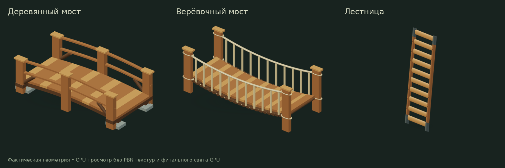
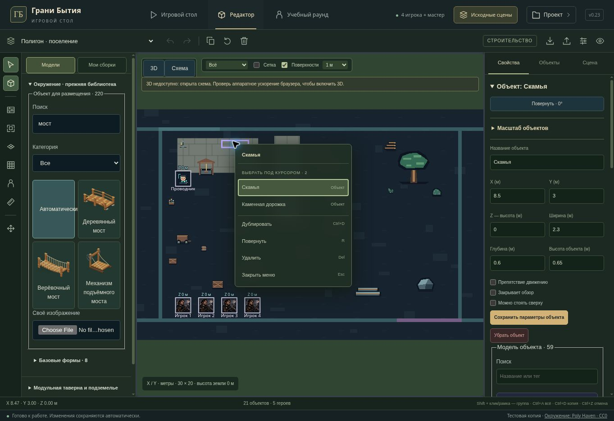

# Original library — v0.23

Continues the existing old asset library. Existing artwork IDs, saved object sizes, scene compositions, campaign rules and hosting audience remain unchanged.

## Geometry

- Wooden bridge: joined arched deck panels without open seams, matching curved load-bearing stringers, stone bearing feet, knee braces, curved rails and pegs.
- Rope bridge: one sampled sag curve governs deck, carrying ropes and handrails. Hangers end at actual rope mesh rings; every deck panel rests on a cross bearer. Low LOD preserves connected construction.
- Ladder: all ten rungs remain in both LODs, mortised ends sit within the side rails, ferrules overlap the ends and high detail adds joint pins.
- Neither bridge nor the inclined ladder is falsely exposed as a flat tabletop at its rail height.
- Regenerated the three actual-mesh library thumbnails. No dependencies or external model downloads added.

| Model | Detailed triangles | Low LOD triangles |
| --- | ---: | ---: |
| Wooden bridge | 3,704 | 832 |
| Rope bridge | 7,424 | 2,088 |
| Ladder | 2,016 | 448 |

## Working in dense original scenes

- Right-click offers a named list of overlapping entities. In 3D it comes from real ray intersections, with one entry per entity rather than per triangle. The schematic uses its actual hit rectangles and painter order, including side view and flat floors.
- Both lists respect the current selection filter, editor-hidden objects and protected layers. SVG clicks can reach an allowed object behind a protected or filtered foreground object, matching the 3D behavior.
- Choosing from the list is read-only: no scene writes, object moves or new undo entries. The inspector follows the chosen object.
- The menu fits within the viewport and scrolls in short windows. Arrow keys, Home and End navigate enabled commands; Escape closes it without clearing selection or nudging the scene. Focus returns to the scene, including the schematic SVG.
- Outside clicks, window blur, resize and external scene replacement dismiss stale menus. Context actions also reflect the existing layer protection state.

## Verification

- `npm run test:tabletop`: **225/225 passed**, including the entire original-model census, five new crossing checks and new overlap/context UI checks.
- Direct editor/viewport run: **66/66 passed**; the final tabletop run also includes the SVG focus regression added afterward.
- `node --test scripts/test-legacy-crossings.mjs scripts/test-legacy-structure.mjs`: **11/11 passed**. Uses actual Three.js meshes/rays, closed directed edge and normal checks, all four facings and three sets of saved proportions, including very flat/narrow dimensions.
- TypeScript and Sites Vite production build passed. Existing large-chunk warnings remain.
- Managed browser: searched new bridge thumbnails, opened the overlap list on the original settlement bench, selected the underlying stone path, navigated/closed the menu with the keyboard and verified focus returned to the scene. These checks did not change saved scene data.

The cloud browser has no WebGL, so browser UI QA uses the schematic fallback. Node geometry/ray tests use actual meshes; viewport UI tests mock the GPU renderer. Final PBR lighting, GPU shadows and RTX 2060 performance are not verified here.

