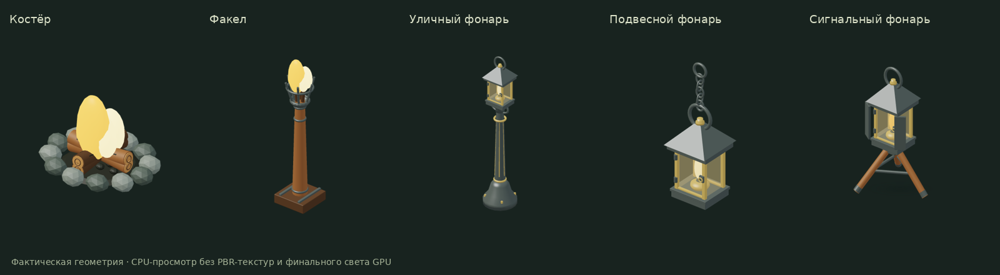
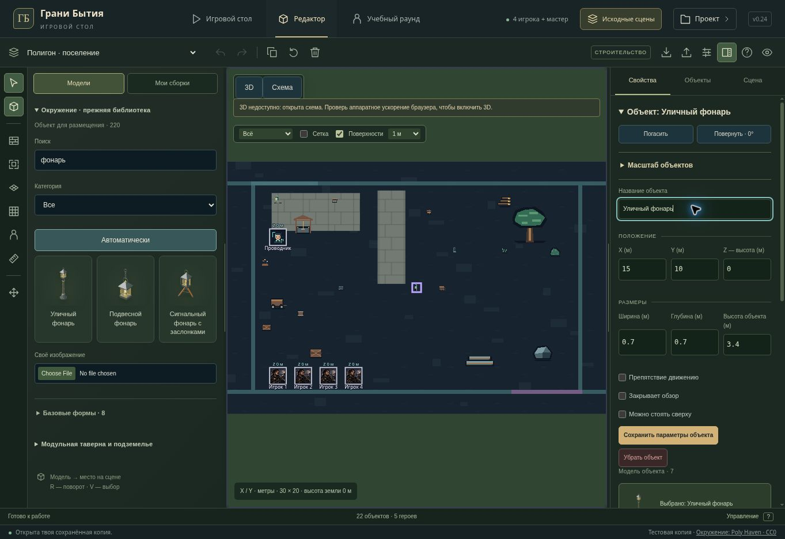

# Original assets and editor — v0.24

Continues the old library and existing scenes, with a desktop interface/control pass. No changes to campaign rules, scene composition defaults, server APIs, save schema or hosting audience.

## Editing and interface

- The master schematic now supports direct object and character dragging in top and side views, retaining the grab offset. A gesture previews the actual group command and commits once on release. Selected supports carry their characters exactly once.
- Uses the existing footprint, height, support, surface placement and layer rules. Single props can snap to verified old furniture tops; groups retain their arrangement. Shift adjusts subsequent movement at one tenth speed and bypasses the grid.
- Escape, pointer cancellation, lost capture, window blur, external scene replacement and new layer protection cancel the in-flight gesture. Read-only view never starts one. Rejected writes restore the authoritative drawing and display the reason.
- Browser QA caught inherited SVGPoint coordinates being lost by object spread; the drag state now copies x/y explicitly. The regression uses inherited coordinate properties too.
- Resizable library and inspector with mouse capture, keyboard arrows, Escape cancellation and double-click/Home reset. Widths and inspector visibility persist per existing account/project workspace scope, separate from scene saves. Older workspace settings retain their layers and acquire default panel sizes.
- `I` hides/restores the inspector; `B` toggles the library. Scene settings explicitly reopen the inspector.
- Added a keyboard-accessible controls dialog via `?`, F1 or the header/footer controls. Its keys do not nudge the scene, focus stays within it and Escape returns focus while preserving the selection.
- Reworked old-library cards, search and categories, selected previews, pagination and file controls to match the existing green/brass editor. The inspector groups coordinates and dimensions into compact three-column sections. Narrower desktop widths constrain panels to leave scene space.

## Five original light fixtures

- Campfire: cut ends and growth rings, scorched log ridges, individual coals and grounded faceted stones.
- Torch: actual open basket and hollow fuel bowl in place of the opaque truncated cone; six prongs, stem collars and anchored base.
- Street, hanging and signal lanterns: four separate glass panes around an empty chamber, hollow hood, burner reservoir and wick collar, door hinges and latch.
- Street lamp has a moulded neck, shaft fluting, braces and anchor bolts. Hanging lamp retains five interlocked chain links in both LODs. Signal tripod adds braces and metal feet.
- Fixed on/off envelopes and bodies retain their saved transforms. Glass and flames cast no opaque shadows. Regenerated the five actual-mesh thumbnails.

| Model | Detailed triangles | Low LOD triangles |
| --- | ---: | ---: |
| Campfire | 6,488 | 816 |
| Torch | 3,788 | 1,028 |
| Street lamp | 5,224 | 1,100 |
| Hanging lantern | 4,832 | 1,168 |
| Signal lantern | 3,644 | 796 |

## Verification

- `npm run test:tabletop`: **236/236 passed**, including the complete old-model census, new light-fixture geometry checks, schematic gestures, surface placement, editor controls, scoped preferences and server tabletop persistence on SQLite/Postgres.
- Focused schematic/editor/workspace run: **39/39 passed**.
- Light fixtures plus original structure tests: **10/10 passed**, using real Three.js mesh rays, source placement outside opaque bodies, open optical paths, four facings, extreme dimensions and on/off body stability.
- TypeScript and the Sites production build passed. Existing large-chunk warnings remain. No dependencies added.
- Managed browser QA checked the real SVG drag and a single undo, model placement, live panel resize by mouse and keys, inspector toggle, controls dialog and restoration after reload. Its test scene is a local QA copy.

The cloud browser lacks WebGL. Browser verification therefore uses the schematic; Node geometry checks use actual meshes, while 3D UI tests mock the GPU renderer. Final PBR lighting/shadows and 2560×1440 FPS on an RTX 2060 are not verified here.

