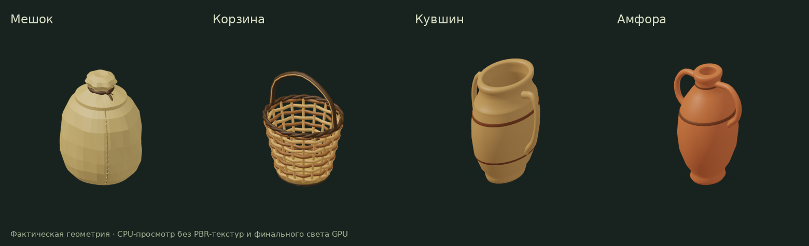
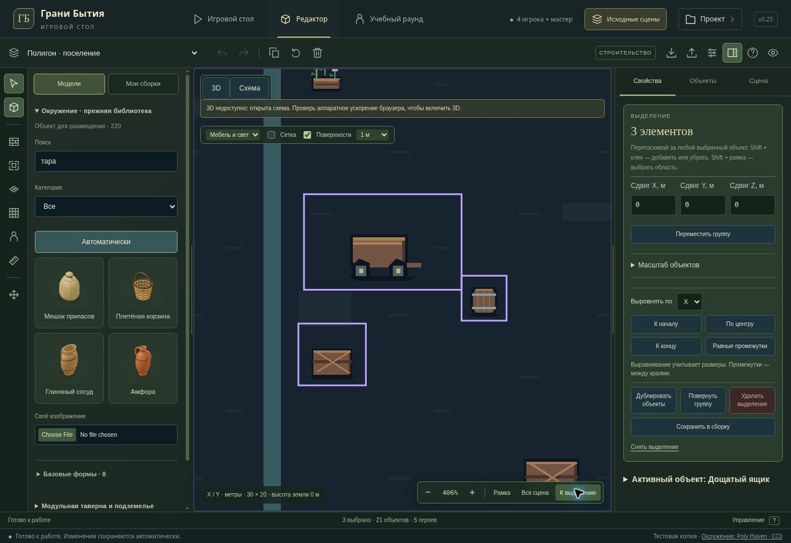

# Original assets and editor — v0.25

Continues the existing library and original scenes. Existing saved IDs, object sizes, scene compositions, campaign rules, disclosure and hosting audience remain authoritative.

## Schematic navigation and selection

- Master schematic now zooms around the mouse position, with a visible 50–1200% scale and matching +/− buttons. Space + left drag or middle drag pans the view; Escape restores the view from the beginning of a pan. Home fits the entire scene; F and “К выделению” fit the complete selected group.
- Camera state is local presentation state, separate from scene data and undo. Pointer coordinates still pass through the actual current SVG matrix after pan/zoom. A grabbed object or active selection frame temporarily blocks wheel zoom to keep the gesture stable.
- Shift + drag adds a rectangle to the selection, matching the existing 3D centre rule, filters and layer protection. A one-use “Рамка” button makes the same gesture available without a modifier and returns to direct dragging afterward. Shift + click retains its single-item behavior.
- Pending selection cancels on Escape, lost capture, window blur, scene replacement or changed layer policy. It does not write the world. The existing direct/group drag still commits through the ordinary editor command, including carried characters and surface placement.
- Added navigation controls and updated the keyboard reference. Caption/readout and controls remain in separate positions in narrow desktop viewports.

## Four original containers

- Sack: physically folded body, seams and stitches, gathered neck, knot and two ties. Open state has a rolled cuff and grain. Body, seams and stitches retain the same final coordinates between states.
- Basket: alternating woven courses around the stakes, doubled woven rim, joined bottom and reinforced handle.
- Clay jar and amphora: hollow thick walls, real bottoms and lips, profiled bases, decorative bands and handle ends embedded in the vessel walls.
- A post-scale correction is restricted to these four models' concave normals under extreme old dimensions. It retains mesh resource identity, part names, triangle order, UV corners and cached bounds.
- Regenerated four actual-mesh thumbnails and added Russian search terms including “тара”, “кувшин” and “плетение”.

| Model | Detailed triangles | Low LOD triangles |
| --- | ---: | ---: |
| Sack, closed | 5,308 | 1,156 |
| Sack, open | 5,652 | 1,028 |
| Basket | 11,840 | 3,606 |
| Clay jar | 3,504 | 1,124 |
| Amphora | 3,376 | 1,076 |

## Observed startup fix

Browser QA encountered the tutorial's remaining direct `crypto.randomUUID()` call on local HTTP. Tutorial session creation now uses the existing Web Crypto UUID helper, with secure random values when randomUUID is unavailable. No weak random fallback or changes to authentication/security settings. The tutorial opens successfully and preserves its independent in-memory world.

## Verification

- `npm run test:tabletop`: **248/248 passed**, including old-model census, vessel contacts/cavities and the schematic camera/selection regression tests.
- Camera and schematic gesture run: **10/10 passed**, covering inherited SVGPoint coordinates, cursor anchor, limits, side view, group focus, filter/layer rules, one-use frame button, cancellation and real placement coordinates after zoom.
- Original vessel/furniture run: **14/14 passed**, including actual ray tests, contacts with weave and handles, four facings, unusual dimensions, fixed sack states and UV/resource preservation.
- Tutorial: **11/11 passed**, including independent session creation without randomUUID.
- Picker/expanded asset checks passed after the search metadata update. TypeScript and the Sites production build passed. Existing large-chunk warnings remain; no dependencies added.
- Managed browser: selected three old props by rectangle and filter, focused that group, zoomed with both buttons and a real wheel, confirmed no undo entries from navigation, searched the four new thumbnails and opened the repaired tutorial.

The cloud browser does not provide WebGL. Browser UI verification uses the schematic fallback; Node mesh/ray checks use actual geometry, while 3D UI tests mock the GPU renderer. Final PBR lighting, shadows and RTX 2060 frame rate at 2560×1440 are not verified here.

