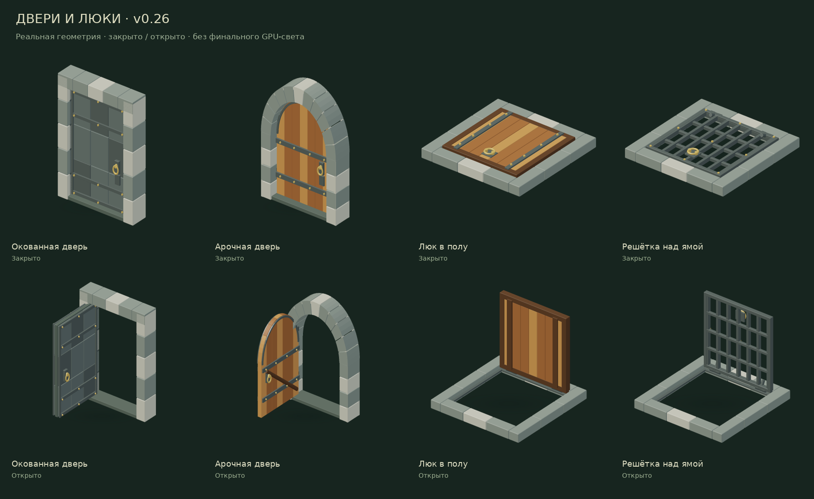
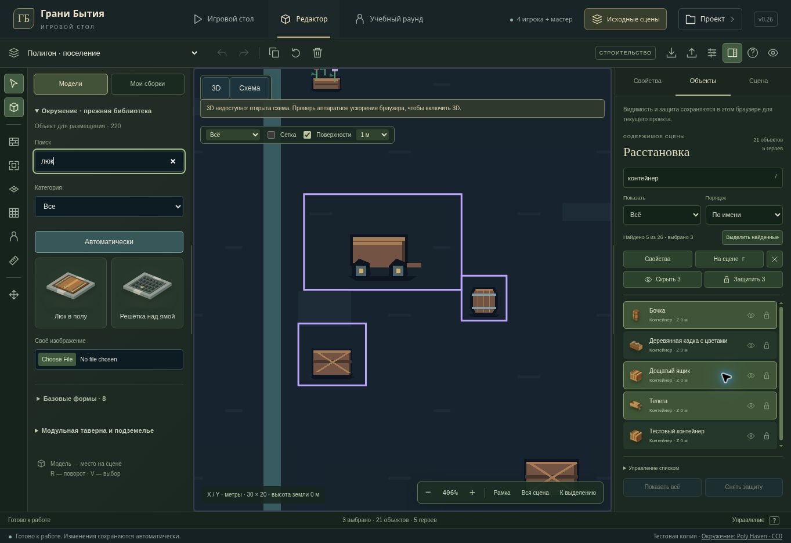

# Original doors and editor — v0.26

Continues the original asset library and existing scenes. Saved IDs, dimensions, motion envelopes, campaign rules and Site audience are preserved.

## Object list and control

- The Objects inspector stays open when choosing a row. Group property forms appear in Properties, leaving the list available for continued selection.
- Search matches all entered words against the object name, model label, type and existing artwork tags. Russian case and ё/е normalize consistently. Filters cover objects, heroes, selection, hidden and protected objects; stable name/type sorting affects presentation only.
- Shift selects a contiguous range in the displayed order. Ctrl/Command toggles an item; Ctrl/Command+Shift adds a range to the existing selection. Arrows select rows, Shift+arrows extend the range, and Ctrl/Command+arrows move focus without changing selection. Space toggles a row. Home/End stay within the list.
- Left/right access the row's visibility and protection controls. Enter or double click opens Properties. F or “На сцене” frames the current group in the active schematic or 3D renderer. Hidden members do not enlarge the focused bounds, even when the primary selection is hidden. Changing focus does not recreate GPU resources.
- O opens the Objects inspector; / or Ctrl/Command+F searches within the list. Ctrl/Command+A selects the filtered rows while native text inputs retain ordinary input selection. Help lists these controls.
- Group visibility/protection is an atomic local workspace update, restricted to selected existing object IDs. Heroes are excluded from these flags. Hidden items are removed from the active selection as before. Existing read-only behavior and local per-project storage remain in force, including the global show/unprotect controls.
- Search, counts and commands stay visible while the rows scroll. Compact model thumbnails and selected/hidden/protected states make the existing library easier to scan. Controls and filters remain separate from scene data and undo.

## Four original moving models

- Iron door: continuous metal core, layered plates, edge rails and straps, two attached ring pulls and lock casing; individually cut stone jambs and threshold.
- Arched door: actual circular plank tops in both LODs, shaped arch bands and stone archivolts, rear brace and two attached pulls. The silhouette no longer relies on stair-stepped rectangular plank tops.
- Both doors use fixed jamb plates, pintles and stationary outer knuckles with coaxial moving centre knuckles. Door handle plates and lock casings embed into the actual leaf, including the locked cover.
- Wooden hatch: connected edge/end rails, boards, underside braces, straps, seating ledges and two hinge assemblies.
- Grate hatch: connected perimeter and crossed bars with true open holes at both LODs, seated pull plate and attached ring. Opening either hatch leaves the passage clear.
- Opening/locking changes only the intended moving parts. Fixed frames and hardware retain identical final coordinates, including unusual old saved dimensions. Shared gate leaf geometry is unchanged.
- Regenerated four actual-mesh library thumbnails and closed/open review images.

| Model | Detailed triangles | Low LOD triangles |
| --- | ---: | ---: |
| Iron door | 7,936 | 1,056 |
| Arched door | 5,724 | 1,348 |
| Wooden hatch | 4,824 | 800 |
| Grate hatch | 4,964 | 836 |

## Verification

- `npm run test:tabletop`: **260/260 passed**, covering the original-model census, editor commands, placement, disclosure, workspace and persistence.
- Focused editor/schematic/3D controls: **83/83 passed**. After the final hidden-primary camera correction, the complete 3D UI file passed **37/37** again. The final editor run passed **38/38**, including a regression for retaining a hidden/protected filter across build/play mode changes. Tests cover filtered/range/keyboard selection, unchanged scene order and coordinates, input isolation, camera framing, layer storage and read-only controls.
- New door tests plus existing structure tests: **11/11 passed**. Real ray tests and intersection points verify cavities, curved profiles, plate backing, hardware and grate/wood contacts, four rotations, fixed frames, unusual dimensions and bounded LOD budgets.
- Managed browser verified range selection of three old props, focus to 406%, group protection, hide/show through the hidden filter, restored selection, name sorting, keyboard row navigation and the two hatch thumbnails. Navigation/layer actions left undo disabled and the scene at 21 objects and five characters.
- TypeScript and the Sites production build pass; existing large-chunk warnings remain. No dependencies added.

The last layout change keeps the help collapsed until needed, leaving room for more rows without moving search or commands.

The browser does not provide WebGL. Browser QA uses the schematic fallback. Geometry tests use actual Three.js meshes and the 3D UI suite mocks GPU rendering. Final PBR light/shadow appearance and RTX 2060 FPS at 2560×1440 remain unverified.

