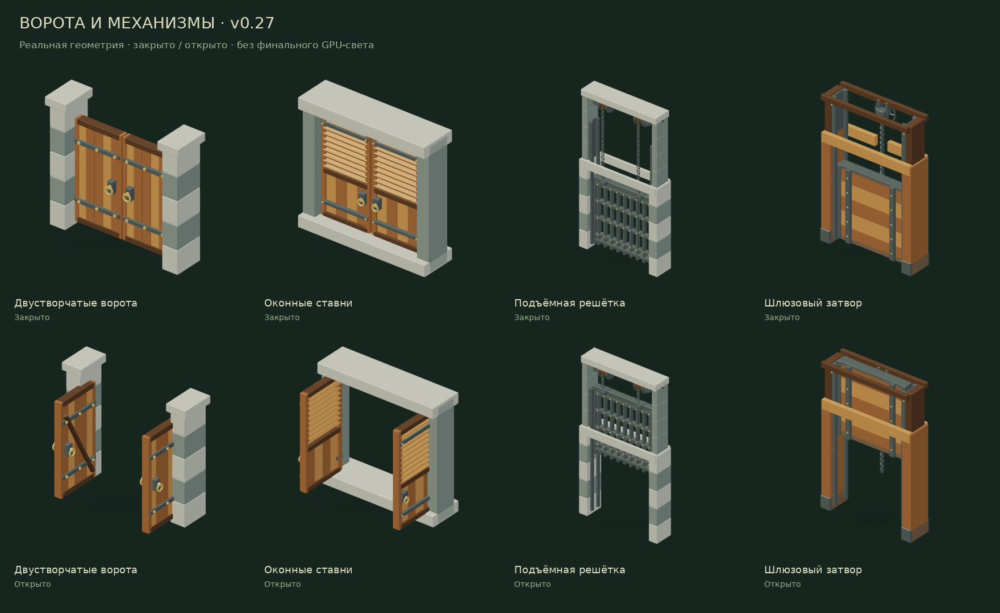
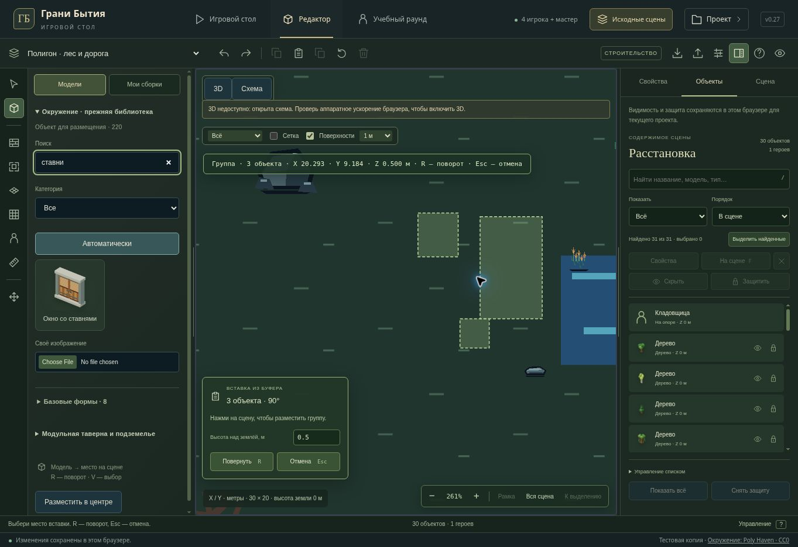

# Original mechanisms and editor — v0.27

Continues the existing private preview, original 220-model library and scenes. Saved object IDs, sizes, movement envelopes, campaign rules and audience remain authoritative.

## Copy and paste between scenes

- Ctrl/Command+C captures a detached snapshot of selected objects, including original artwork, dimensions, facing, state and relative height. Characters and their original support relationships stay in the source scene. Existing assembly validation bounds a copy to 64 objects.
- Ctrl/Command+V opens placement with a 3D ghost or a schematic footprint preview. R rotates the group; the visible panel edits height over the target scene's ground. One click assigns new object IDs and commits one ordinary editor command; one undo removes the complete insertion.
- Escape cancels placement and restores the prior selection, including when focus remains in the list or height input. The clipboard remains available for another paste. Ctrl/Command+Z during pending placement cancels the preview first. Scene editing keys cannot accidentally move or delete the source while placing a copy.
- Buttons in the command bar and context menu expose the same commands. The buffer belongs to the current project/session and is cleared across project changes. It neither changes the saved assembly library nor reads/writes the operating system clipboard.
- Read-only or play mode ends pending placement. No open target scene, invalid height, stale callbacks, scene limits and changed project scope cannot create partial copies. Ground elevation in another scene preserves the copied relative height.

## Placement precision and schematic preview

- Visible placement candidates now carry an explicit resolved-coordinate marker. Commit still revalidates bounds, surfaces and world data, but avoids rounding the displayed point a second time. This fixes a real mismatch at a non-grid-aligned scene edge for both assemblies and individual old models.
- The schematic draws every copied assembly member at its rotated, clamped footprint in top or side view. Preview positions follow the actual SVG matrix after wheel zoom or pan. Rotation and height update without an extra pointer move.
- Invalid height, group size or object-count limit is shown in red and cannot be committed from the schematic. Leaving the view, losing focus or cancelling removes the preview. Coordinates and placement controls occupy separate positions.
- Editor, object-list and camera letter shortcuts also work with a Russian keyboard layout, using the physical Latin key when the reported character is not Latin. Text fields retain native typing and clipboard behavior.

## Four original mechanisms

- Double gate: connected framed leaves, rails, braces, straps, two-sided ring pulls and common-axis pintle hinges with stationary masonry plates.
- Shutters: separate lower panels and real overlapping angled louvres seated in their stiles. The upper section no longer has a solid slab behind its slats. Closed front views stay screened; angled air gaps are real; open leaves clear the window.
- Portcullis: connected lattice and perimeter, guide channels, bearing-supported hoist axle, winding drums, interlocking chain links and attached lift eyes. Moving parts have physical clearance through the crosshead.
- Sluice: joined blade boards, stiles and straps, a real helical screw behind the blade, travelling nut/yoke, supported gearbox and attached wheel. The raised blade clears the lower opening.
- Open/closed variants retain byte-identical fixed frames and hardware. Old movement envelopes and the v0.26 doors/hatches are unchanged. High and low LODs preserve their physical openings and silhouette.
- Regenerated four actual-mesh thumbnails and eight closed/open review views. Browser QA exposed the missing search alias “ставни” for “Окно со ставнями”; aliases now also cover шлюз, винт and герса without changing stable model keys.

| Model | Detailed triangles | Low LOD triangles |
| --- | ---: | ---: |
| Double gate | 8,424 | 1,472 |
| Shutters | 7,696 | 1,248 |
| Portcullis | 12,040 | 3,524 |
| Sluice gate | 7,262 | 1,618 |

## Verification

- Final `npm run test:tabletop`: **278/278 passed**, including old-model census, editor/clipboard, placement, keyboard-layout regression, workspace, disclosure and SQLite/Postgres persistence.
- Focused controls/assembly run: **99/99 passed**. The 3D UI file, including the additional edge-coordinate test, passed **38/38**. Current complete coverage is in the 278-test final run.
- New mechanisms plus existing structure and v0.26 door tests: **17/17 passed**. Real rays and solid contact points cover hinges, handle backing, louvre gaps, lattice/chain/drum contacts, screw/nut/yoke/gearbox connections, clearance, saved unusual sizes and four quarter turns.
- The final picker/expanded-asset checks passed after search-alias updates. TypeScript and the Sites production build pass; existing large-chunk warnings remain. No dependencies added.
- Managed browser: copied three old settlement props; pasted them with a 90-degree rotation in the same scene; undid all three together. Switched to the original forest scene, pasted the retained group at Z 0.5 m (30→33 objects, one character unchanged), then undid to 30. Escape from the height input removed the preview and retained the buffer. Wheel zoom, live footprint preview and the repaired “ставни” search were verified. Browser clipboard shortcuts are reserved by the browser-control harness, so browser QA used the visible command buttons; DOM keyboard regressions cover Ctrl/Command+C/V and Russian layout.

The cloud browser does not provide WebGL. Browser QA uses the schematic fallback, mesh/ray checks use actual Three.js geometry, and 3D UI tests mock GPU rendering. Final PBR light/shadow appearance and RTX 2060 FPS at 2560×1440 remain unverified.

