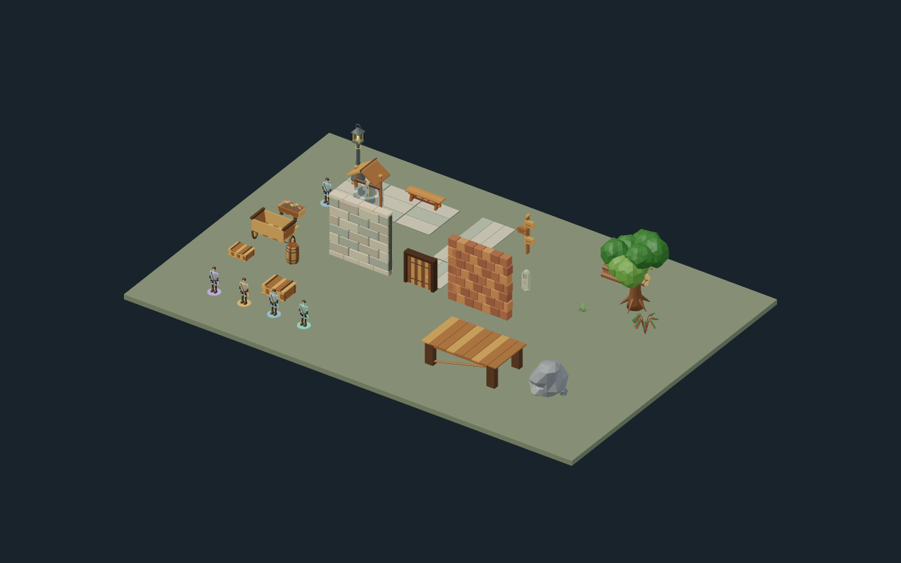
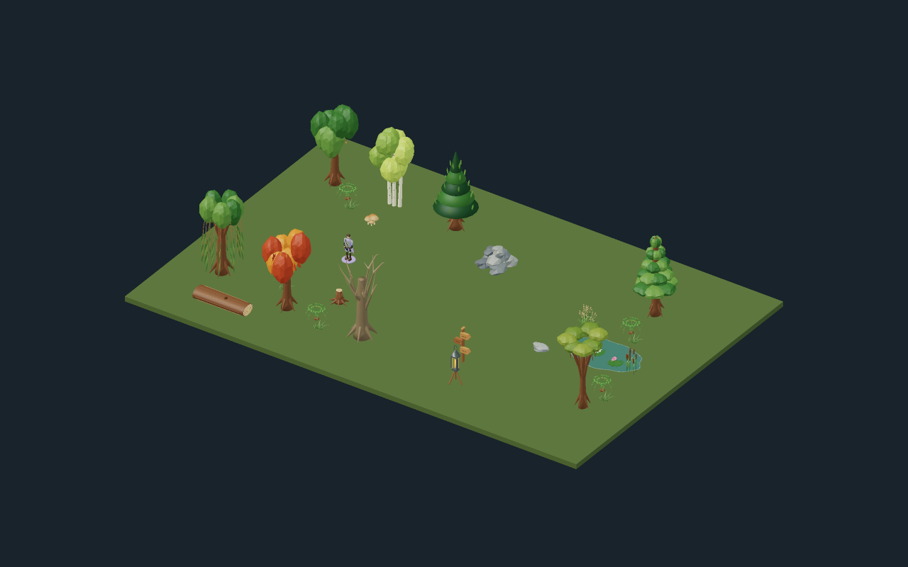
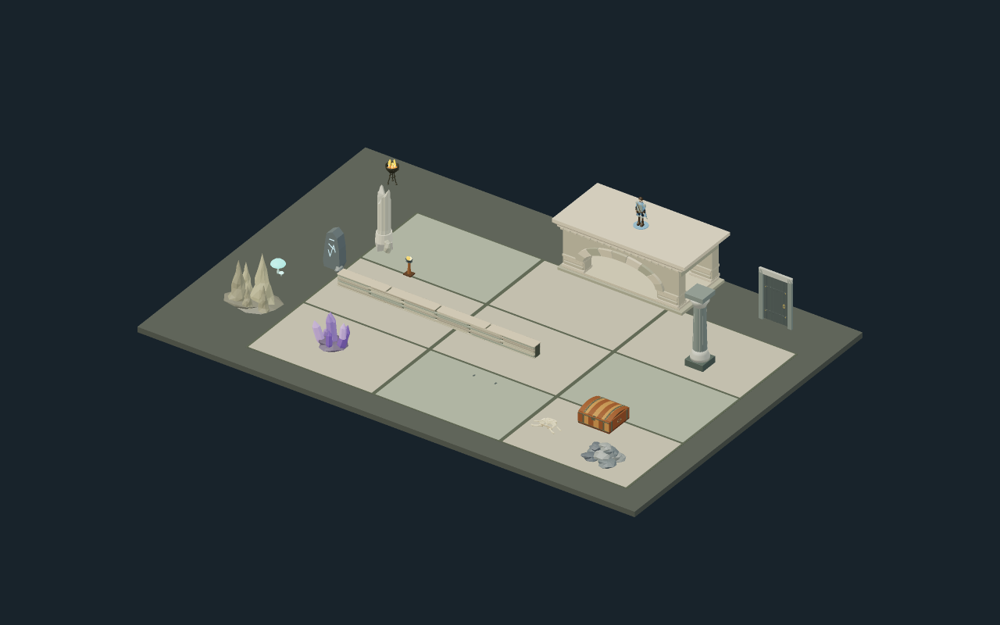
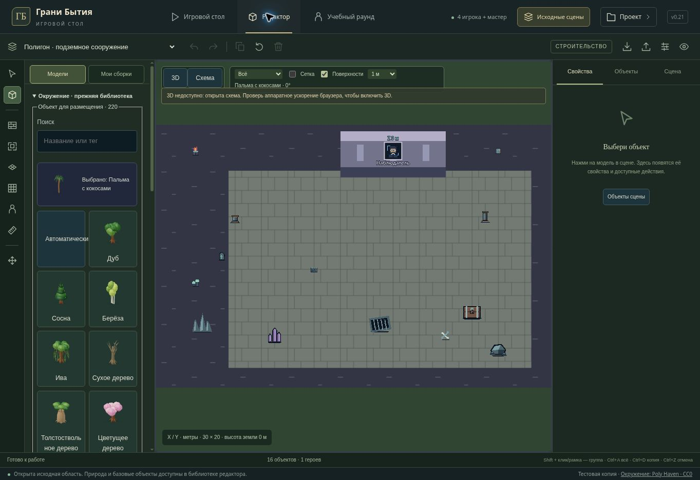

# Existing environment assets — v0.21

The original environment library and the original settlement, forest and underground sandbox are the focus again. The video tavern and the user's existing work remain accessible.

## Models and editor

- All 220 existing artwork IDs now select their own 3D presentation: 52 flora, 38 minerals, 60 furniture constructions, 53 structures, plus 17 aliases to detailed native models. The saved logical kind, ID and artwork stay unchanged.
- Fixed the missing artwork field in master/disclosed render adapters and the generic pine/boulder GLB replacement which previously erased selected tree, plant, crystal and prop silhouettes. Remembered objects use only their disclosed snapshot.
- Solid botanical forms, roots, branches, leaf clusters, cut timber, hollow vessels, real masonry/bar/frame openings, construction hardware and mineral cavities. All families have cheaper low-detail geometry.
- Motion envelopes keep fixed bodies stationary when lids, doors, drawers, gates, hatches, flames or lanterns change state. Height on moving objects includes clearance; it is not automatically treated as a flat support plane.
- Shared material batching applies to legacy plants/rocks as well as construction props, including low quality. The integrated 880-variant census found at most 11,232 triangles per object and at most six batched material groups. These are geometry counts, not measured GPU timings.
- New placements use object-specific dimensions and flags. Existing custom saved dimensions/flags remain authoritative. Preview, R rotation, full-footprint bounds, surface placement and undo use the same resolver as commit. The furniture selection filter recognizes old furniture whose logical kind remains `platform`.
- 220 actual-mesh thumbnails (about 1.26 MiB total) replace the flat illustrations in the editor picker. Original SVG artwork remains available to the 2D scene view. The old library is open first; basic forms and modular tavern parts remain accessible.
- Project menu stacking/closing corrected. In the 2D fallback, zero-height native floors now render as floor patterns beneath objects rather than opaque platform pillars.

## Original scenes and compatibility

Fresh copies start in the original settlement with four player figures. One-click original-scene access and menu entries open the same three scene IDs. Original objects, NPCs, actors, campaign/atlas links and the upper support at Z=3 are retained.

The settlement has 21 objects, forest 30, underground 16. Original trees use distinct species, and the locations have wells, carts, plants, cut timber, pond vegetation, mineral formations and masonry details. Additional dressing does not introduce gameplay barriers or new support surfaces. Outdoor and underground lighting defaults suit each location; existing user lighting preferences still take precedence.

When loading an older browser copy, a fully untouched stock scene receives the revised environment. An edited scene receives only artwork on exactly unchanged stock objects. Its custom objects, dimensions, deleted objects, composition, tokens, active scene and names remain intact. The update is idempotent. No saved-data schema migration or production database operation is involved.

## Verification

- `npm run test:tabletop`: 200/200 passed, including the 880 model combinations (220 IDs × two LODs × two size/facing configurations), solid topology, real raycast openings, fixed state bodies, placement, support, privacy, persistence and UI regressions.
- `npm test`: passed, including original scene and world-entity compatibility.
- `npm run test:server`: 572/572 passed using local SQLite/PGlite fixtures.
- `npm run test:models`: 18/18 passed.
- Final targeted editor/preview/picker checks: 43/43 passed. Final 3D UI/floor-fallback checks: 31/31 passed. TypeScript and the Sites Vite build passed.
- Browser QA: original scene navigation, picker search, actual thumbnail loading, editor/library layout and menu behavior checked on the managed preview.

The cloud browser lacks WebGL. Its 2D fallback and UI were checked; real mesh geometry/cameras/rays were checked in Node with the WebGL renderer mocked for UI tests. Final PBR frames, GPU shadows and 2560×1440 FPS on the user's Ryzen 5 7400F / RTX 2060 have not been measured.

## Review images

These three images render the actual meshes and placements with a CPU geometry renderer. They omit texture maps, real-time shadowing, bloom and GPU post-processing and should not be presented as final lighting proof.

Reproduce thumbnails with `node scripts/generate-legacy-thumbnails.cjs` and scene geometry views with `node scripts/render-original-scenes.cjs`.
