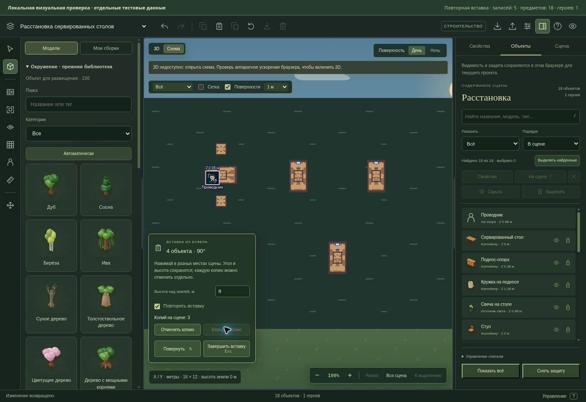

# Повторная вставка из буфера

28 октября 2026. Продолжение рабочей версии редактора основного сайта «Грани Бытия».

## Расстановка нескольких композиций

В панели Ctrl+V появился переключатель «Повторять вставку». После каждого успешного размещения предпросмотр остаётся на сцене с тем же углом и высотой; можно сразу выбрать следующее место. Счётчик показывает число оставленных на сцене копий текущей расстановки. Вставляется независимый снимок буфера, предметы получают новые идентификаторы, исходная сцена и её герои сохраняются.

«Отменить копию» / Ctrl+Z убирает последнюю целую композицию, «Вернуть копию» / Ctrl+Shift+Z или Ctrl+Y возвращает её. Предпросмотр остаётся открытым. История до начала текущей расстановки из этого режима недоступна: отмена всех копий не затрагивает предыдущие правки. Новое размещение после undo очищает прежнюю ветвь redo.

Esc, V или «Завершить вставку» завершает режим и выделяет последнюю оставшуюся копию. Если все копии отменены или ни одной не было, возвращается прежнее выделение с прежним активным объектом. Буфер остаётся доступным. Повторный Ctrl+V внутри открытого режима сохраняет его параметры; после завершения новый Ctrl+V начинает обычную однократную вставку с выключенным повторением.

Новая панель использует прежние угол, высоту, сетку, границы и предпросмотр сборки. Её высота ограничена областью сцены; длинное содержимое прокручивается. Повторение не записывается в постоянные настройки и не включается само при следующем открытии.

## Целостность и смена контекста

Каждая копия проходит прежнюю атомарную проверку сцены и создаёт один шаг истории. Отказ сохранения, некорректная высота и превышение лимита 250 объектов оставляют сцену и счётчик без изменений. После исправления можно продолжать расстановку. Скрытие и защита объектов продолжают действовать; защищённую созданную копию нельзя удалить через undo до снятия защиты.

Изменение настроек вставки, успешное размещение, завершение и новый запуск создают новое состояние текущего режима. Обработчик старого жеста не может разместить вторую копию, даже если версия мира не менялась между отменой и повторным открытием. Двойной вызов завершения одного жеста записывает только одну композицию.

Внешняя замена черновика, смена сцены, аккаунта/лобби, переход в игровой режим или отзыв права редактирования останавливают предпросмотр. Старый обработчик после этого не пишет сцену. Уже созданные копии сохраняются. Буфер доступен в прежнем проекте; другой проект его не получает. Обработчики после размонтирования редактора тоже прекращают работу.

Формат сцен, серверные маршруты, миграции и игровые правила не менялись. Данные режима существуют только во время работы редактора; обычное сохранение и согласование черновика используют прежний путь.

## Проверка

Добавлены 13 сценариев: 10 для настоящего React-интерфейса и 3 для границ истории, счётчика и возвращаемого выделения. Проверены три последовательные композиции с едиными углом/высотой и новыми ID, сохранность героя, undo/redo без выхода из режима и без затрагивания прежних правок, выбор предыдущей копии после undo, новая ветвь истории, повторный Ctrl+V, ввод в поле высоты и Esc из поля. Отрицательные сценарии охватывают отказ записи, недопустимую высоту, лимит объектов, устаревшие обработчики, смену контекста и защиту новой копии.

| Проверка | Результат |
| --- | --- |
| Финальный целевой прогон редактора и сборок | 94/94 |
| Полный `npm run test:ui` | 345/345 |
| Полный `npm run test:tabletop` | 421/421 |
| TypeScript и production-сборка | Успешно |
| Линтер | 0 ошибок; 49 прежних предупреждений |
| `git diff --check` | Без ошибок |

Наборы пересекаются, их числа не складываются. Итоговые TAP-отчёты проверяются по полной сводке с нулями fail/cancelled/skipped/todo. Первые общие прогоны вернули нулевой код, но не сохранили итоговый TAP-блок; они не засчитаны. Полные повторные отчёты, первоначальные логи и машинная сводка находятся в `.verification/repeat-paste/`. Осталось прежнее предупреждение сборки о размере отдельных JS-модулей.

В управляемом браузере проверен настоящий SceneEditor с отдельными тестовыми данными и сохранением в память проверочной страницы. Из одного буфера по четыре предмета расставлены три композиции с углом 90°: стало 18 предметов и один исходный герой. Отмена дала 14 предметов и счётчик 2; возврат восстановил 18 предметов и счётчик 3, сохранив предпросмотр. Завершение выделило четыре предмета последней копии без новой записи мира. Проверочная страница удалена после осмотра.

WebGL в этом браузере недоступен: визуально проверена схема. Проверка пользовательского GPU, света и FPS этим прогоном не выполнена.

Рабочая ветка — `work/editor-integration`. Публичный GitHub, основной сайт, API и производственная база этим шагом не обновлялись.
