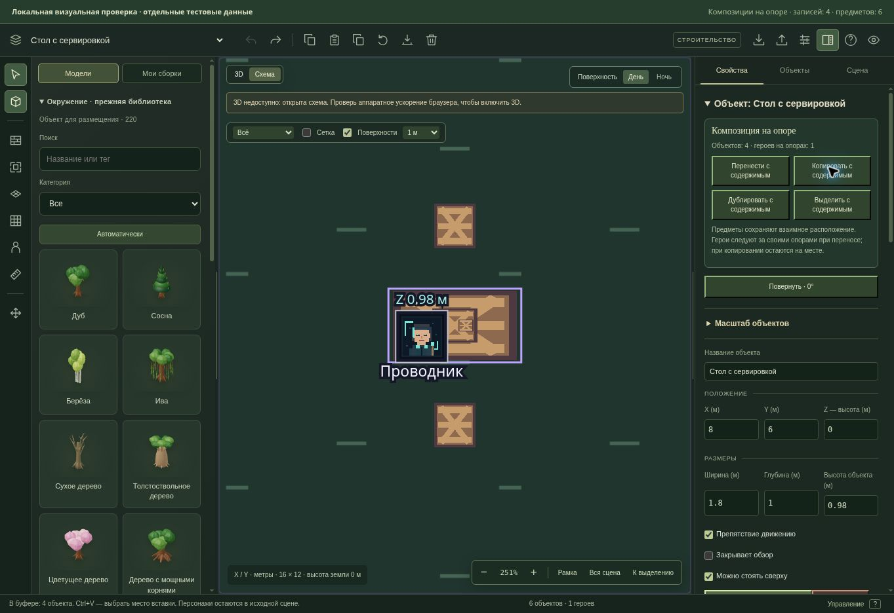

# Композиции на опорах

28 октября 2026. Продолжение рабочей версии редактора основного сайта «Грани Бытия».

## Работа с мебелью и содержимым

В свойствах плоской опоры и контекстном меню появились команды:

- «Перенести с содержимым» — выбирает опору и расположенные на ней предметы, затем включает перенос. Следующее место на сцене задаёт положение композиции; взаимное расположение и высоты сохраняются.
- «Копировать с содержимым» — помещает независимый снимок предметов в существующий буфер редактора. Ctrl+V позволяет вставить композицию в другую сцену, повернуть её и изменить высоту. Все новые предметы получают новые идентификаторы.
- «Дублировать с содержимым» — сразу создаёт копию всей композиции рядом. Копия целиком помещается в границах сцены.
- «Выделить с содержимым» / Shift+G — готовит группу для существующих команд переноса, поворота, масштаба и сохранения в сборку.

Содержимое определяется по полному контакту предмета с подходящей поверхностью, включая вложенные опоры: например, стол → поднос → кружка. Соседний стул, парящий предмет и предмет, не помещающийся на поверхности, не добавляются. Выбор пола не захватывает всю комнату. Постоянная связь между предметами не создаётся: обычное одиночное выделение и Ctrl+C/D сохраняют прежний смысл.

В панели показано число предметов и героев на их опорах. Герои переносятся существующими командами ровно один раз, с сохранением опоры; их размер при масштабе не меняется. Автоматически найденный герой больше не становится явно выбранным элементом. Поэтому занятая композиция доступна для масштаба и сохранения в сборку, а Del отказывается удалять мебель под героем. Если мастер сам включил героя в выделение, это явное намерение сохраняется. Копии и буфер содержат только предметы; герои остаются на исходных опорах.

## Целостность действия

Скрытое или защищённое вложение блокирует действие с композицией целиком: частичная расстановка и неполная замена буфера не выполняются. Проверка использует текущие слои. Устаревший обработчик после замены сцены или контекста отклоняется.

Перенос, дублирование и вставка используют существующую атомарную запись и одну запись истории. Отказ сохранения, выход за границы и превышение 250 объектов не создают частичного результата или шага undo. В режиме просмотра доступны выделение и копирование; записывающие команды выключены. В игровом режиме новые инструменты строительства скрыты.

Формат сцен, серверные маршруты, игровые правила и миграции этим блоком не менялись. Сохранение и согласование черновика продолжают использовать существующий путь редактора.

## Проверка

Добавлены 11 сценариев: 8 в настоящем React-интерфейсе и 3 для геометрии/политики выделения. Проверены вложенные опоры, перенос героя ровно один раз, undo/redo, масштаб без изменения размера героя, сохранение занятой композиции в сборку, явное выделение героя, свежие идентификаторы копий, независимость буфера и вставка в другую сцену. Отрицательные сценарии включают скрытые и защищённые вложения, режим просмотра, игровой режим, отказ записи, устаревший обработчик и превышение лимита объектов.

| Проверка | Результат |
| --- | --- |
| Полный `npm run test:ui` | 335/335 |
| Полный `npm run test:tabletop` | 408/408 |
| Первый целевой прогон редактора и поверхностей | 83/83 |
| Финальный повтор набора редактора | 74/74 |
| TypeScript и production-сборка | Успешно |
| Линтер | 0 ошибок; 49 прежних предупреждений |
| `git diff --check` | Без ошибок |

Наборы пересекаются; их числа не складываются. Каждый TAP-отчёт проверен по полной итоговой сводке, включая нули fail/cancelled/skipped/todo. Логи и машинная сводка находятся в `.verification/contents/`; итог — `summary.json`. Осталось прежнее предупреждение сборки о размере отдельных JS-модулей.

В управляемом браузере открыт настоящий SceneEditor с отдельными тестовыми данными и сохранением только в память проверочной страницы. Проверены копирование четырёх предметов, дублирование, одна отмена, перенос всей сервировки с героем и возвращение исходных координат. После дублирования было 10 предметов и один герой, после отмены — 6 предметов и тот же герой. Проверочная страница удалена после осмотра. WebGL в этом браузере недоступен; визуально проверена схема. Работа пользовательского GPU и 3D-свет этим прогоном не подтверждены.

Изменения зафиксированы в рабочей ветке `work/editor-integration`. Публичный GitHub, основной сайт, API и производственная база этим шагом не обновлялись.
