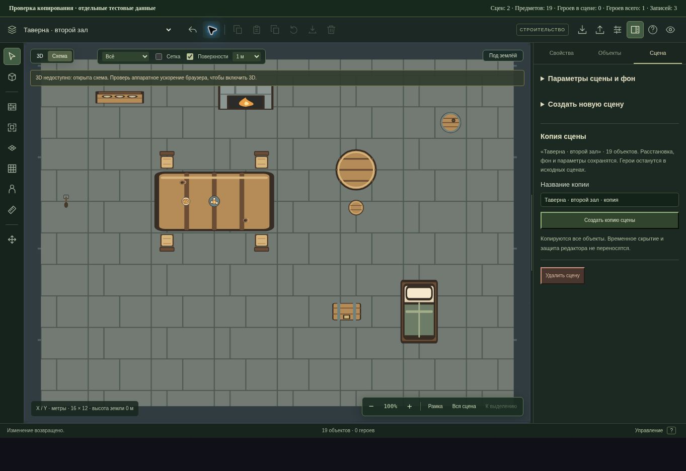

# Копирование оформленной сцены · 28 октября 2026

В конструкторе открой «Параметры сцены» → «Копия сцены», задай название и нажми «Создать копию сцены». Можно подготовить второй зал, этаж или вариант комнаты на основе готовой обстановки. Новая сцена появляется сразу после исходной и открывается в редакторе.

## Что входит в копию

Сохраняются все объекты, их координаты и размеры, высоты, модели каталога и прежние изображения, повороты, состояния открытия, огня и замков. Копируются описание, проекция, окружение, фон, размер его повторения, границы и длительность раунда сцены. Копирование использует сохранённое состояние; незавершённая форма параметров не применяется автоматически.

Сцена и каждый предмет получают новые проверенные ID. Копия независима от исходника, а остальные сцены и их порядок сохраняются. Подсказка названия учитывает существующие названия и предел в 120 символов; своё название можно ввести вручную.

Герои не клонируются и не переносятся. Их единственные позиции и ссылки на опоры остаются в исходных сценах. Журнал, восприятие, раскрытия и игровые часы не входят в команду редактора. Формат SceneState и маршруты API не менялись.

Копируются и временно скрытые или защищённые предметы: исходные объекты не изменяются. В новой сцене они видны и доступны для редактирования. Локальные слои исходника остаются на месте; игровые состояния вроде запертого сундука сохраняются в копии.

## Создание и отмена

Команда выполняет одну запись и добавляет один шаг истории. Отмена удаляет всю копию и возвращает прежнюю открытую сцену. Возврат восстанавливает ту же копию с теми же ID. После успешного создания завершается прежний инструмент вставки и очищается выделение. Отказ записи оставляет сцену, форму и инструмент в прежнем состоянии.

Предел — прежние 20 сцен и 250 предметов на сцену. Сцена с 250 предметами копируется целиком. При достижении лимита сцен кнопка недоступна; команда дополнительно проверяет предел. Некорректное имя, отсутствующая сцена, ошибка или повтор генератора ID отклоняются до записи. Двойное событие формы не создаёт две копии. Режим игры, отсутствие права редактирования, размонтирование и устаревший обработчик после смены сцены, проекта или внешнего состояния не записывают копию.

## Проверка

Добавлены 9 сценариев в существующий набор редактора. Проверены все 35 моделей каталога и прежний объект, состояния, параметры, независимость данных, новые ID, сохранение героев и опор, пустая сцена и предел в 250 предметов, прежняя допустимая геометрия у края, лимит сцен, названия и атомарные отказы. Реальный SceneEditor в JSDOM проверяет открытие копии, очистку инструмента, undo/redo, слои, отклонённую запись, повторное событие и устаревшие обработчики.

| Проверка | Результат |
| --- | --- |
| Целевые новые сценарии | 9/9 |
| Полный `npm run test:ui` | 370/370 |
| TypeScript и production-сборка | Успешно |
| Линтер | 0 ошибок; 49 прежних предупреждений |
| `git diff --check` | Без ошибок |

Наборы пересекаются; их числа не складываются. Проверены все шесть TAP-отчётов, финальные счётчики и нули fail/cancelled/skipped/todo. Логи и машинная сводка находятся в `.verification/scene-copy/`. Полный серверный набор и правила боя повторно не запускались: сервер, расчёты и миграции этим изменением не затронуты. Сохраняется прежнее предупреждение сборки о размере отдельных JS-модулей.

В управляемом браузере проверен настоящий SceneEditor с отдельными тестовыми данными. Из комнаты с 19 предметами и одним героем на столе создан второй зал: 19 предметов, 0 героев в копии, 1 герой во всех сценах. После одной отмены снова была 1 сцена с героем на опоре; после возврата — 2 сцены и прежняя копия. Счётчик показал ровно 3 записи за создание, отмену и возврат. После проверки тестовая страница удалена.

WebGL в этом браузере недоступен: визуально проверена схема. GPU, итоговая 3D-отрисовка и FPS этим прогоном не измерялись.

Изменения находятся в `work/editor-integration`. Публичный GitHub, основной сайт, API и производственная база этим шагом не обновлялись.
