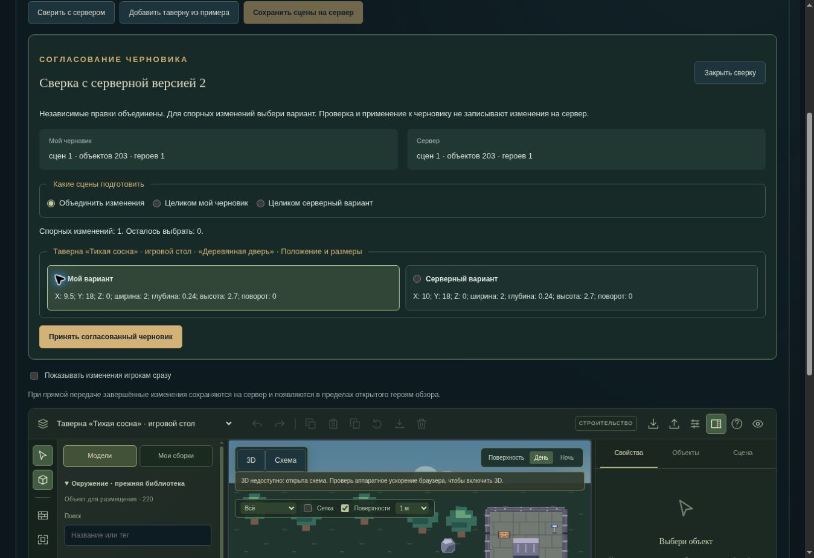

# Согласование черновиков сцен

28 октября 2026. Продолжение рабочей ветки `work/editor-integration` после `a5c65bd`; основной сайт и закрытый полигон этим шагом не публикуются.

## Поведение

Мастер или помощник со сценовыми правами открывает «Сверить с сервером». Редактор получает свежие сцены, актёров и номер версии, сохраняя местную работу. Во время чтения можно продолжать редактирование; сверка строится по последнему местному варианту на момент ответа.

В сверке показываются независимые изменения и споры. Например, местный перенос стола сохраняется вместе с серверным открытием двери и перемещением героя после игрового раунда. Если изменено одно и то же положение, мастер выбирает нужный вариант в двух карточках. Нет автоматического решения спорной правки.

«Принять согласованный черновик» меняет только местный черновик и его основу. Прямая передача выключается. Сохранение на сервер остаётся отдельным действием через прежний узкий API сцен. До следующего изменения или сохранения доступна отдельная отмена согласования: она возвращает прежний местный черновик и не откатывает сервер.

Можно выбрать целиком местный или серверный набор сцен. Интерфейс явно сообщает, что правки второго набора в этот вариант не попадут. Это также помогает разобрать несовместимость независимых изменений, например уменьшение сцены в черновике и свежую серверную позицию за её границей. Старый черновик без исходного снимка читается, но требует явного выбора целого варианта: безопасного основания для автоматического объединения у него нет.

## Правила объединения

| Данные | Поведение |
| --- | --- |
| Название, описание, фон и остальные независимые поля | Совпавшие или изменённые только с одной стороны принимаются; разные правки одного поля требуют выбора. |
| Размеры и уровни сцены | Составляют одну группу для выбора. |
| X/Y/Z, поворот и габариты объекта | Составляют одну группу: исключён гибрид поворота и другого сохранённого габарита. |
| Модель и изображение объекта | Выбираются вместе при споре. |
| Открытие, замок, свет, преграды и опора объекта | Составляют группу состояния и свойств; конкурирующие операции не смешиваются молча. |
| Создание и удаление | Отдельные новые элементы объединяются. Удаление изменённого элемента требует решения. Сохранение спорно удаляемой сцены сохраняет её содержимое. |
| Положение героя | Разрешается целиком вместе с опорой среди всех сцен. Два одновременных переноса не создают две фигурки одного героя. |
| Исключённый герой | Не возвращается из местной копии без явного решения; итог со ссылкой на отсутствующего героя не принимается. |

Объекты сравниваются внутри своей сцены: допустимые одинаковые идентификаторы в двух разных сценах не смешиваются. Исходные данные не мутируются. Порядок ключей JSON не считается правкой; порядок сцен и объектов следует серверному списку с добавлением местных новых элементов. Конфликты существования сцены могут раскрыть дополнительный спор о положении героя после выбора — список пересчитывается.

Итог проходит прежние проверки формата, максимумов 20 сцен / 250 объектов, границ, высот, опор и актуального состава героев. Согласование не назначает падение, перемещение или новую стоимость действия ради исправления несовместимости.

## Хранение, запросы и права

- В прежнем формате `world6.scene-draft.v1` появилось необязательное `baseScenes`. Исходник запоминается при загрузке и подтверждённой записи. Старые записи совместимы; повреждённая база не принимается.
- Если во время прямой передачи были новые местные правки, подтверждается только отправленный снимок. Именно он становится основой следующей сверки, а более свежий черновик сохраняется.
- Исходник — местные метаданные, он не отправляется в API. Его размер проверяется отдельно и не отнимается от прежнего сетевого бюджета 8 МиБ. Недостаток места в localStorage сохраняет прежний запасной режим памяти с уведомлением.
- Смена аккаунта, лобби или доступа к API изолирует ожидающие ответы. Изменение черновика или новая серверная версия после сверки блокирует применение старого результата.
- Сверка не расширяет роль помощника. Сервер повторно проверяет разрешения и ревизию в транзакции при PUT. Ещё одна правка между GET и PUT даёт обычный конфликт без частичной записи.
- Новых серверных маршрутов, зависимостей или миграций в этом блоке нет. Ранее подготовленная миграция компонентов остаётся в общем ожидающем выпуске и описана в отчёте интеграции.

## Проверка

| Набор | Результат |
| --- | --- |
| `npm run test:editor-sync` | 35/35: 16 логики объединения, 17 передачи/сверки и хранения, 2 серверных сценария |
| Полный `npm run test:ui` | 327/327, включая те же 17 сценариев передачи/сверки |
| TypeScript и production-сборка Vite | Успешно |
| Линтер | 0 ошибок; 49 прежних предупреждений в общей кодовой базе; в новом блоке предупреждений нет |
| Браузер | Выбор спора, применение и отмена проверены на тестовой странице |

Все указанные TAP-отчёты завершены: без падений, отменённых или пропущенных сценариев. Промежуточный запуск без итоговой сводки не учитывался; финальный пакет 35/35 выполнен заново и завершён. Сводка и хеши затронутых исходников: `.verification/scene-sync/summary.json`. В сборке осталось прежнее предупреждение о крупных JS-модулях. Полный серверный набор и модели были проверены на предыдущем этапе; здесь повторно проверены затронутые пути. Проверки используют изолированные данные.

Проверка логики покрывает независимые поля одной двери, атомарный поворот/габарит, конкурирующие замок и открытие, одинаковые правки и порядок ключей, удаление предмета и сцены, восстановление содержимого, перенос из удаляемой сцены, два переноса между сценами, одинаковые ID предметов, исключение героя, конфликт размеров с позицией, общий предел 20 сцен, старый черновик, необязательные поля и унаследованные решения.

Интерфейс проверяет отдельные чтение/применение/запись, выбор спора, актуальную ревизию PUT, отсутствие исходника и актёров в его теле, выключение прямой передачи, продолжение работы при медленном GET, инвалидирование сверки после правки/события/отзыва доступа, поздний ответ другого аккаунта, отмену, чтение после перезапуска, повреждённую базу и прежний бюджет.

Настоящий серверный сценарий на SQLite и PostgreSQL/PGlite: ограниченный помощник сохраняет местный перенос стола и новый предмет, пока игрок через существующий раунд перемещается и открывает дверь. После применения раунда сверка сохраняет оба результата. Третья серверная запись между сверкой и сохранением отклоняет устаревший PUT; новая сверка сохраняется с новой версией. Листы героев, часы и журнал уже сыгранного раунда не перезаписываются, перезапуск сохраняет результат, отзыв разрешения блокирует запись.

В браузере на локальной странице с тестовым адаптером пройдены сверка, выбор положения двери, применение и отмена. Снимок выше показывает настоящий компонент на отдельных тестовых данных, а не подключение к рабочему API. WebGL недоступен; схема работает. Графика 3D и FPS этим блоком не проверены.
