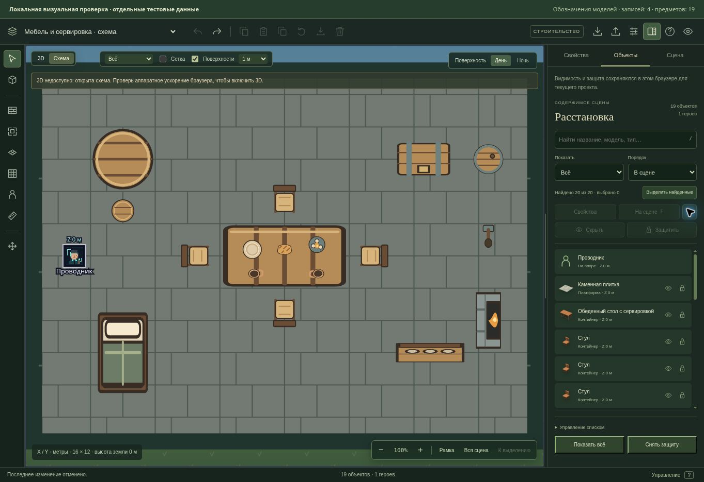
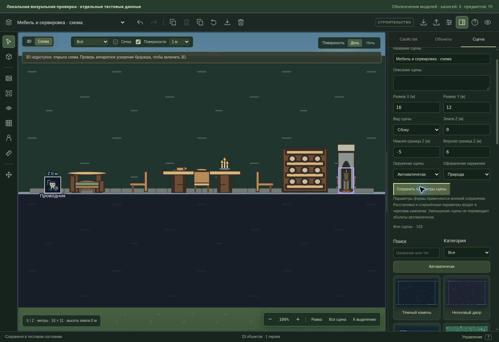

# Читаемые обозначения моделей на схеме

28 октября 2026. Продолжение рабочей версии редактора основного сайта «Грани Бытия».

## Мебель, посуда и свет

Схема раньше выбирала рисунок только по общему типу объекта. Стол, стул, кружка и сундук относятся к `crate` для прежних правил взаимодействия, поэтому получали одинаковый значок ящика. Теперь автоматическое изображение использует идентификатор модели, не меняя её тип и игровые свойства.

Для всех 32 моделей каталога, кроме трёх существующих напольных покрытий, добавлены рисунки сверху и сбоку. Различаются прямоугольный и круглый столы, стулья, табуреты, скамьи, кровать, стойка, полки, бочка, сундук, кружка, тарелка, хлеб, источники света, стены, окна, дверь, крыша, ступени и ловушки. SVG сохраняет резкость при увеличении; новые рисунки не требуют внешних изображений, фильтров или анимации.

В плане учитывается поворот по четырём направлениям. Боковые рисунки сохраняют вертикальную ось и меняют профиль или зеркальные детали по направлению. У опор верх рисунка выровнен по высоте поверхности; тонкая посуда рисуется в нижней части прежней области захвата с учётом небольшой толщины. Минимальная область выбора 0,2 м сохранена.

Открытые дверь, арка и сундук имеют другое изображение. Горящие и погашенные источники света отличаются наличием пламени; люк, шипы и огненная ловушка показывают переданное состояние активации. Новые обозначения используют уже существующие поля и не создают новых игровых состояний.

## Выбор, изображения и карта игрока

Области выбора, координаты, габариты, привязка, перенос, слои и персонажи остаются в прежних компонентах. Рисунки не перехватывают указатель. Восемь базовых типов без модели сохраняют прежние значки; неизвестная или несовместимая модель использует базовый рисунок. Прежний экспорт `SceneGlyph` сохранён.

Явно выбранное изображение имеет прежний приоритет. Напольные покрытия продолжают использовать существующие узоры. Поддержка прежних изображений окружения и пользовательских картинок не заменяется новым рисунком.

Конструктор мастера и карта игрока используют общий компонент обозначений. Карта игрока получает только прежний набор разрешённых объектов; для запомненных предметов рисует сохранённый снимок, сохраняя приглушение и обрезку по раскрытым областям. Текущие изменения скрытого света или сундука не подставляются в запомненное состояние.

Формат сцен, маршруты API, права, миграции и игровые правила не менялись. Отрисовка сама не пишет мир и не меняет игровые часы.

## Проверка

Добавлены 9 сценариев в существующем наборе схемы. Они проверяют обе проекции всех 32 моделей, различимость мебели/посуды, запасные значки, открытие и активацию, поворот и высоты, тонкие предметы, прежние области выбора, явные изображения и полы. Отдельно проверены защита при захвате за деталь рисунка, перенос композиции с героем, отсутствие скрытого предмета у игрока, сохранённый погашенный свет при изменившемся текущем состоянии и клавиатурное действие с раскрытым объектом.

| Проверка | Результат |
| --- | --- |
| Финальный целевой набор схемы | 20/20 |
| Полный `npm run test:ui` | 361/361 |
| TypeScript и production-сборка после выравнивания | Успешно |
| Линтер | 0 ошибок; 49 прежних предупреждений |
| `git diff --check` | Без ошибок |

Наборы пересекаются; их числа не складываются. Итоговые TAP-сводки проверены вместе с нулями fail/cancelled/skipped/todo. Логи и машинная сводка находятся в `.verification/schematic-glyphs/`; итоговый целевой прогон — `targeted-final.log`. Полный набор интерфейса включает прежние сценарии HTTP/UI, прямую передачу сцен, рабочее место, схемы, 3D/UI и редактор.

В управляемом браузере осмотрен настоящий SceneEditor с отдельной тестовой комнатой из 19 предметов. Проверены вид сверху и сбоку, стулья в четырёх направлениях, сервировка на столе, переключение вида через обычную форму и возврат. У погашенного факела до действия было 0 элементов пламени, после «Зажечь» — 1, после одной отмены — снова 0; число предметов сохранилось. После осмотра тестовая страница удалена.

WebGL в этом браузере недоступен: визуально проверена схема. Проверка производительности, света и отрисовки на пользовательском GPU этим прогоном не выполнялась. Осталось прежнее предупреждение production-сборки о размере отдельных JS-модулей.

Изменения находятся в `work/editor-integration`. Публичный GitHub, основной сайт, API и производственная база этим шагом не обновлялись.
