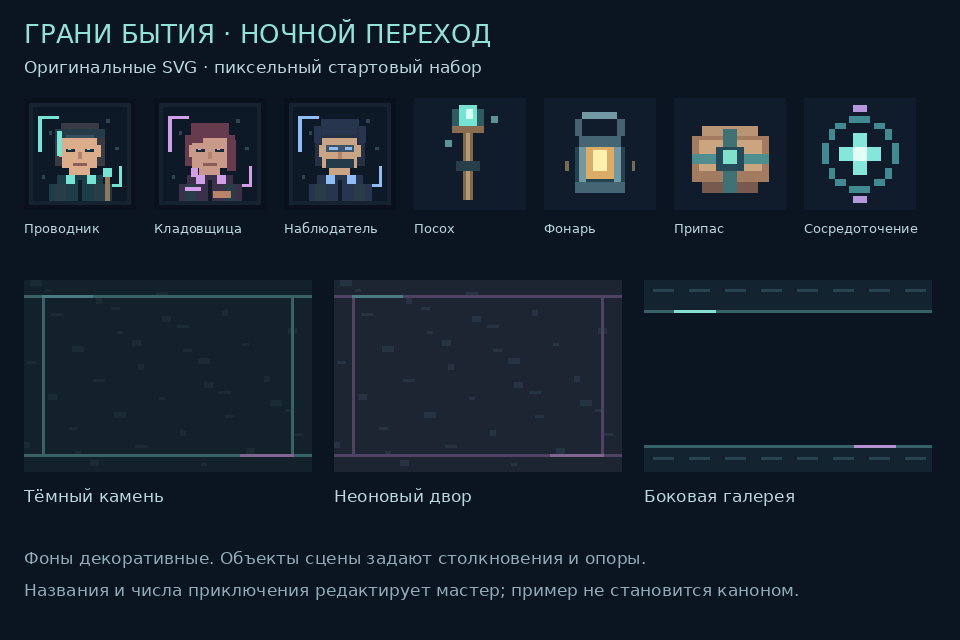

# R06 · материалы «Граней Бытия»

Новый набор используется в необязательном примере «Ночной переход» и доступен в обычных редакторах. Оформление тёмное, с неоновыми акцентами; оно не утверждает наличие определённых технологий в каноне. Сетка пикселей изображения не является сеткой передвижения: X/Y/Z остаются свободными координатами.

## Новые материалы

Все десять SVG написаны в этом изменении, без внешних картинок, шрифтов, скриптов и сетевых зависимостей. Исходники: `src/assets/starter/`. Посвящение CC0 1.0 находится в `LICENSE.txt` и относится только к этим SVG. Общий объём SVG — **16 411 байт**; зависимости проекта не добавлены.

| Материал | Исходник | Где используется |
| --- | --- | --- |
| Портрет проводника | `portrait-guide.svg`, 64×64 | NPC, выбор портрета |
| Портрет кладовщицы | `portrait-keeper.svg`, 64×64 | NPC, выбор портрета |
| Портрет наблюдателя | `portrait-watcher.svg`, 64×64 | NPC, выбор портрета |
| Посох | `item-staff.svg`, 32×32 | Каталог и инвентарь, выбор изображения |
| Фонарь | `item-lantern.svg`, 32×32 | Каталог и инвентарь, выбор изображения |
| Припас | `item-ration.svg`, 32×32 | Каталог, товар торговца, выбор изображения |
| Сосредоточение | `effect-focus.svg`, 32×32 | Значок способности, выбор изображения |
| Тёмный камень | `ground-stone.svg`, 96×64 | Фон сцены у перехода, выбор фона |
| Неоновый двор | `ground-yard.svg`, 96×64 | Фон двора, выбор фона |
| Галерея | `gallery.svg`, 96×64 | Фон боковой сцены, выбор фона |

Предпросмотр отрендерен из исходных SVG и просмотрен визуально. В изображениях `shape-rendering="crispEdges"`; галерея интерфейса использует `image-rendering: pixelated`. Это статические изображения: значок эффекта не объявляется анимацией заклинания.

SVG принимаются через известные ключи реестра `visualMedia`; загрузка произвольного SVG/внешнего URL не разрешена. Своё растровое изображение по-прежнему обрабатывается существующим загрузчиком PNG/JPEG/WebP. Техническая палитра сцены не меняет игровые свойства.

## Уже имеющиеся материалы

| Группа | Наличие в исходниках | Происхождение и ограничения |
| --- | --- | --- |
| Окружение | Восемь встроенных SVG-глифов в `SceneViewport.tsx`: стена, дверь, дерево, камень, контейнер, платформа, свет, вода | Существующий код проекта. Их прежняя история авторства отдельно не восстанавливалась; новую CC0-лицензию на них не распространяем |
| Атлас | 11 WebP, 2 843 282 байта: три портрета, оружие, броня, артефакт, расходники, камень, баннер, фигура спереди/сзади | Существующие файлы. Источник и отдельное разрешение использования в доступных материалах не подтверждены; свободную лицензию не приписываем |
| Магия | 45 файлов, 1 556 537 байт: изображения групп и знаки направлений | Существующие файлы; канонический каталог в этом изменении не пересматривается. Происхождение изображений отдельно не подтверждено |
| Анатомия | 8 файлов, 5 777 772 байта | Существующие файлы; изображения и анатомический 3D не заменены. Происхождение растров отдельно не подтверждено |
| 3D | Действующие `BodyViewport`, формы предметов и параметры размеров | Процедурное отображение сохраняется; новые предметы используют действующие параметры, а не новые импортируемые модели |

## Что этот набор ещё не покрывает

Стартовый набор позволяет собрать небольшую сцену и пример приключения. Полной библиотеки для всех рас, городов и способностей, направленных спрайтов, анимированных боевых эффектов, чёрной дыры/физики и больших наборов тайлов здесь нет. Они не объявляются готовыми. Подтверждение происхождения прежних растров остаётся отдельным пунктом подготовки к выпуску.

Полный фон сцены остаётся доступен мастеру: игрок получает индивидуально раскрытые области, объекты и контакты. Передача всего фона игроку могла бы показать неизвестную местность, поэтому существующая граница выдачи сохранена.
