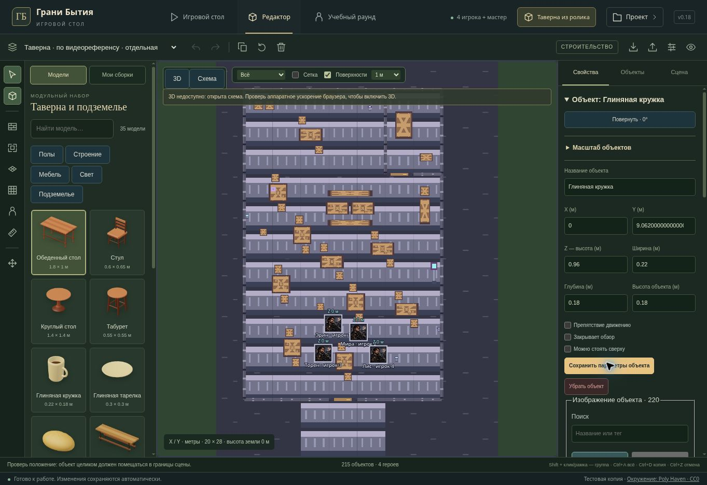

# Исправления редактора · v0.18

Выпуск исправляет воспроизведённые ошибки управления, импорта, сохранений и геометрии. Он не означает, что все возможные ошибки найдены. Доступ существующего закрытого Sites-превью сохраняется; основная ветка GitHub, рабочий Render и производственная база не меняются.

## Исправленные ошибки

| Область | До исправления | Поведение v0.18 |
| --- | --- | --- |
| Оси XYZ | Перенос по одной оси округлял сеткой другие координаты и высоту. | Привязка действует только на выбранную ось. Групповой предпросмотр учитывает габариты предметов и высоту всех участников. |
| Границы сцены | Перемещение, поворот, копирование и форма свойств могли оставить часть предмета за краем. | Новые пространственные операции проверяют полный габарит. Копирование у края сохраняет взаимное расположение группы; неверная операция отклоняется целиком. Уменьшение сцены также проверяет размещённые предметы. |
| Асинхронный импорт | Чтение файла могло завершиться после переключения проекта, изменения сцены или включения режима чтения. | Перед применением проверяются актуальные права, проект, состояние и персонажи. Устаревший импорт не записывается. |
| Защита слоёв | Импорт и отмена проверяли защиту только текущей сцены и могли пропустить недавно включённую защиту. | Проверяются актуальные скрытые и защищённые объекты во всех затрагиваемых сценах. |
| Сохранение браузера | Сообщение об ошибке хранилища исчезало после открытия примера или сброса, хотя запись по-прежнему не работала. | Постоянное предупреждение остаётся до успешной записи. Редактор сообщает, когда изменения есть только в памяти, и предлагает экспорт. Повреждённые данные отличены от недоступного API хранения. |
| Подписи | Скрытая модель оставляла видимую подпись. | Подпись скрывается и возвращается вместе с объектом. |
| Резервная схема | Правая и средняя кнопки мыши могли размещать или выбирать объекты. | Изменения выполняются левой кнопкой. |
| Текстуры | Редактирование размеров растягивало зерно материала, поскольку UV вычислялись до окончательного масштаба модели. | UV проецируются после завершения геометрии и её локального преобразования; плотность материала остаётся постоянной. |
| Поверхности мебели | Столешницы находились ниже записанной высоты опоры; предметы над ними висели в воздухе. | Верх столов, табуретов, стойки и крышки бочки совпадает с высотой опоры. В обоих уровнях детализации проверены повороты и независимые изменения размеров. Кровать исключена из плоских опор: высота изголовья не является высотой матраса. |

## Посуда и сохранённые сцены

Кружка, тарелка и хлеб доступны отдельными моделями библиотеки. У кружки есть реальная полость и закрытое дно; нижняя поверхность всех трёх предметов лежит на высоте размещения. В новой таверне 215 редактируемых объектов и четыре персонажа; 42 предмета посуды и еды стоят на столах самостоятельными объектами.

Кнопка **«Таверна из ролика»** открывает новый пример с отдельной посудой. Сохранённый пример v0.17 остаётся отдельной сценой с прежними идентификаторами персонажей и объектами. Повторное открытие v0.18 не заменяет внесённые в него изменения.

Данные старых сцен не мигрируют автоматически. Читатель сохранений сохраняет совместимость с прежними предметами, частично выступавшими за край; новые пространственные изменения проверяются строже. Обновлённые модели мебели больше не включают неподвижную встроенную посуду. Для добавления посуды в старую сцену используются новые модели; для совместного переноса стола и посуды нужно выделить их группой — автоматического родительства нет.

## Проверка

- `npm run test:tabletop`: **139/139** — управление, настоящий raycast и геометрия Three.js, поверхности, сохранения, импорт, защита, undo/redo и серверное хранение сцен.
- После последней корректировки актуального контекста импорта и зависимости камеры повторно проверены затронутые взаимодействия и размещение: **53/53**.
- `npm test`: **199/199** тестов в четырёх TAP-наборах; скрипт проверки правил также завершён успешно.
- `npm run test:server`: **572/572**, на локальных тестовых SQLite и PostgreSQL/PGlite.
- `npm run test:models`: **17/17**. Часть геометрических тестов пересекается с набором игрового стола; результаты не суммируются в число уникальных тестов.
- TypeScript и сборка закрытого превью проходят. `npm run lint` завершён с кодом 0; существующие предупреждения в других участках проекта остаются, это не заявление об отсутствии всех замечаний статического анализа.

В управляемом браузере загружена v0.18, открыт редактор, выбрана отдельная кружка и проверен отказ сохранения недопустимой координаты. Предмет и число объектов остались прежними.

В этом браузере WebGL недоступен. Интерфейс проверен в резервной схеме; геометрические проверки используют реальные меши, камеры и лучи, но GPU-рендерер в UI-тестах заменён. Итоговые PBR, тени, экспорт WebGL-canvas и FPS на RTX 2060 при 2560×1440 здесь не подтверждены.

## Геометрическое превью

Для осмотра фактических мешей сохранены [широкий](assets/tavern-v018-geometry-landscape.png) и [портретный](assets/tavern-v018-geometry-portrait.png) CPU-кадры. Воспроизведение: `node scripts/render-reference-tavern.cjs tavern-v018-geometry`.

Текущий пример: **588 492 треугольника, 465 групп материалов**, включая четыре подробные фигурки. Это структурный подсчёт до теневых и постобрабатывающих проходов, а не время кадра или число всех GPU-отрисовок. CPU-кадры показывают форму и базовые цвета без текстур, PBR и настоящих теней.
