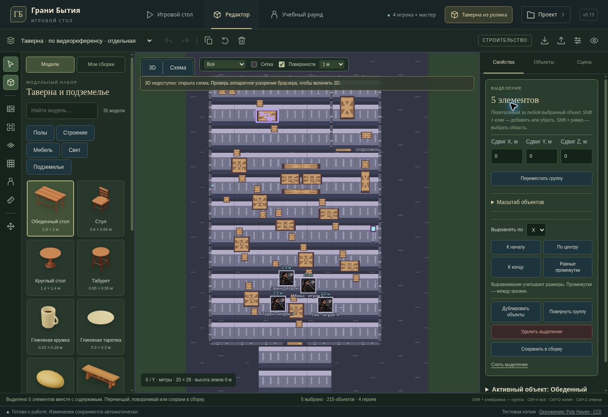

# Геометрия и точное управление · v0.19

Обновление закрытого полигона «Грани Бытия». Сцена по видеореференсу сохраняет 215 объектов и четырёх объёмных персонажей; пользовательские сохранения и идентификаторы сцен остаются совместимыми. Основная ветка GitHub, рабочий Render, производственная база и аудитория превью не меняются.

## Управление

**Точный перенос.** Начни обычное перетаскивание левой кнопкой, затем удерживай Shift: движение замедляется в десять раз, привязка к сетке временно отключается. Переключение режима учитывает последующее движение мыши и не пересчитывает весь путь заново. Во время переноса выводятся координаты X/Y/Z и величина сдвига в метрах. Отпускание применяет одну команду; Escape отменяет предпросмотр. Координата подтверждения совпадает с показанной: повторного округления сеткой больше нет.

Shift до начала захвата сохраняет прежнее назначение: добавление в выделение или выбор рамкой. Точный режим перетаскивания доступен в 3D; резервная схема сохраняет точное редактирование через поля свойств и форму сдвига группы.

**Мебель с содержимым.** В свойствах и контекстном меню опоры появилась команда **«Выделить с содержимым»**, также Shift+G. Она добавляет предметы, действительно стоящие на плоском верхе, вложенные опоры и персонажей с явно записанной опорой. Соседние стулья, висящие предметы и предметы за краем не добавляются. Выбор пола не захватывает всю комнату. Скрытые и защищённые предметы вызывают сообщение вместо молчаливого неполного выделения.

Стол и выбранная посуда перемещаются или поворачиваются одной командой с обычной отменой. Поворот теперь использует центр полных габаритов выделения: маленькая кружка на краю не смещает центр вращения стола. Копирование по-прежнему копирует предметы, сохраняя уникальность персонажей. Это явное групповое выделение, а не автоматическое постоянное родительство.

**Высота над опорой.** При переносе мебели со стоящим героем проверяется полная высота фигуры. Если она не помещается под верхней границей сцены, отменяется весь перенос.

## Поверхности

Расчёт размещения отделён от наружных габаритов коллизии. Для круглого стола, табурета и бочки используется вписанный эллиптический контур плоского верха. Он учитывает суженную крышку, обод, скругления и многоугольник экономной модели. Для прямоугольной мебели предусмотрен отступ от кромки; при повороте на 90° или 270° отступы меняются местами вместе с геометрией.

Сундук с округлой крышкой исключён из автоматических плоских опор: его записанная высота включает дугу открывания, а не высоту закрытой крышки. Существующие положения предметов и правила опор персонажей не мигрируют. Обычный базовый контейнер с плоской крышкой остаётся доступной опорой.

Новая проверка запускает настоящие лучи Three.js под каждым углом принятого габарита предмета, во всех четырёх поворотах, после независимого изменения размеров и в обоих уровнях детализации. Разрешённое размещение должно иметь реальную поверхность на заявленной высоте.

## Геометрия

Барная стойка получила закрытый деревянный корпус, утопленные филёнки с двух сторон, стойки рам, шканты, профили цоколя и кромок, железную перекладину для ног с креплениями. Скамья получила арочные опоры, фигурные царги, распорку, подкосы, выступающие шипы соединений и шканты заподлицо. Доски столешниц имеют толщину; верх остаётся на записанной высоте, а центр в обоих уровнях детализации сплошной. Встроенной посуды нет.

| Модель | Подробная геометрия | Экономная геометрия | Группы материалов после объединения |
| --- | ---: | ---: | ---: |
| Барная стойка | 6 776 треугольников | 536 | 3 |
| Скамья | 1 600 треугольников | 232 | 2 |

Обновлены миниатюры библиотеки. [Стойка](assets/tavern-v019-bar.png) и [скамья](assets/tavern-v019-bench.png) показаны отдельными CPU-кадрами фактической геометрии и базового цвета — без текстур, PBR и настоящих теней.

В таверне с четырьмя подробными фигурками теперь **591 024 треугольника и 465 групп материалов**. По сравнению с v0.18 добавлено 2 532 треугольника, число групп материалов не выросло. Это структурные показатели до теневых и постобрабатывающих проходов, а не измеренный FPS.

[Широкий ракурс](assets/tavern-v019-geometry-landscape.png) · [Портретный ракурс](assets/tavern-v019-geometry-portrait.png). Воспроизведение: `node scripts/render-reference-tavern.cjs tavern-v019-geometry`.

## Свет и тени

Выбор активных источников учитывает мощность, дальность и расстояние до области обзора. Камин может получить теневую карту вместо немного более близкой маленькой свечи. Небольшие колебания камеры не заставляют карты постоянно переключаться. Скрытие родительской группы также выключает источник и освобождает его карту.

Бюджет сохранён: до восьми активных локальных источников, четыре в экономном режиме; один локальный источник с тенями в сбалансированном режиме, два в высоком и ни одного в экономном. Положение каждого кандидата вычисляется один раз за обновление вместо многократного вычисления при сортировке. Это контроль стоимости, не заявление об измеренном ускорении.

## Проверка

**152/152 проверки игрового стола прошли**, включая геометрию всего набора, реальные камеры и лучи, точный захват, подтверждение координат, высоту героя, новые поверхности, выделение содержимого, групповой поворот, защиту слоёв, сохранения, undo/redo и локальное серверное хранение сцен SQLite/PostgreSQL. TypeScript и сборка закрытого превью проходят. Сохраняется предупреждение сборщика о крупных существующих чанках.

В управляемом браузере открыта v0.19 и проверена новая команда: стол и четыре самостоятельных предмета выбраны как пять элементов без записи сцены. Ниже показан интерфейс резервной схемы.

WebGL в этом браузере недоступен. Геометрия, логика света и бюджеты проверены кодом и реальными объектами Three.js; UI-тесты заменяют GPU-рендерер. Итоговые PBR, светотеневой кадр, экспорт WebGL-canvas и FPS на RTX 2060 при 2560×1440 здесь не подтверждены. Пиксельное совпадение с роликом не заявляется.
